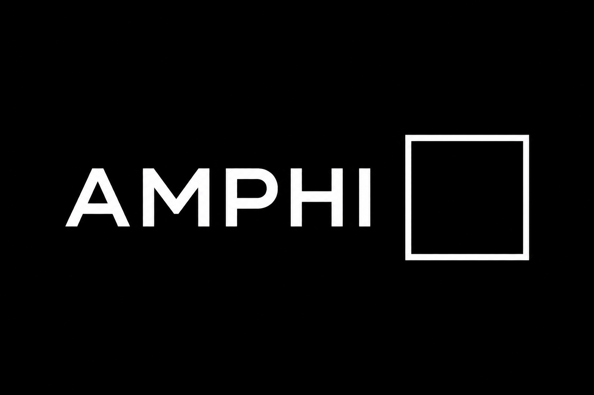
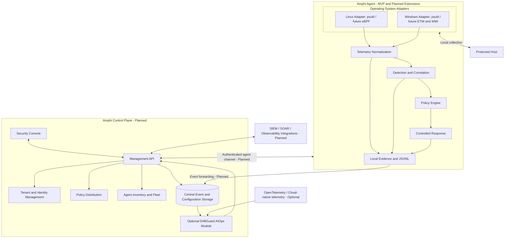
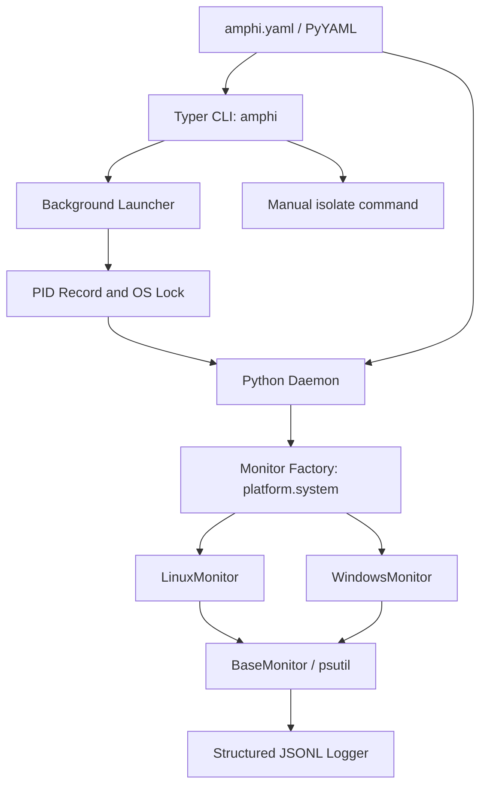
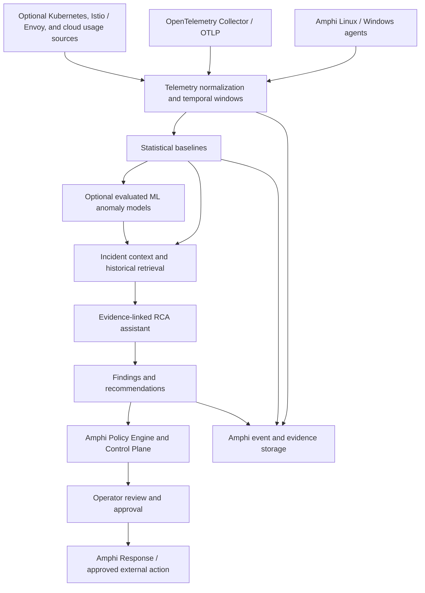
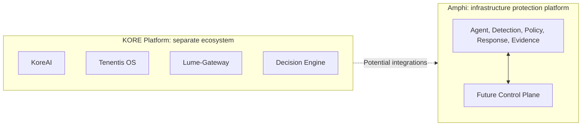

<div align="center">

# Amphi

### The Autonomous Immune System for Critical Infrastructure

<p align="center">
  
</p>

*Stop building walls. Start growing organisms.*

**Cross-platform infrastructure monitoring, threat detection, platform observability, and controlled response.**


---

> **Project status: Pre-alpha — functional Python MVP.**
>
> Amphi has moved beyond an empty repository skeleton. The current MVP contains a Python CLI, a background daemon, YAML configuration, cross-platform process monitoring abstractions, JSONL logging, and manual process-containment commands for Linux and Windows. The current implementation is intentionally narrow: it monitors process resource usage and supports explicit process suspension or termination. It is **not yet a production EDR, an autonomous response platform, or a complete critical-infrastructure security product**.
>
> The broader architecture in this README describes the intended direction. Features are labelled as implemented, planned, or research so that design goals are not confused with working capabilities.

---

## Table of Contents

- [Project Overview](#project-overview)
- [Project Status](#project-status)
- [The Problem](#the-problem)
- [The Vision](#the-vision)
- [Target Customers and Product Profiles](#target-customers-and-product-profiles)
- [Built Environment and Civil Engineering](#built-environment-and-civil-engineering)
- [Expansion Plan: Seven Capability Pillars](#expansion-plan-seven-capability-pillars)
- [Design Principles](#design-principles)
- [System Architecture](#system-architecture)
- [Current MVP Architecture](#current-mvp-architecture)
- [Long-Term Core Components](#long-term-core-components)
- [DriftGuard — AIOps and Platform Observability](#driftguard--aiops-and-platform-observability)
- [Cross-Platform Strategy](#cross-platform-strategy)
- [Policy and Detection Model](#policy-and-detection-model)
- [Amphi Control Plane](#amphi-control-plane)
- [Security Response and Containment](#security-response-and-containment)
- [Forensics and the Glass Box Philosophy](#forensics-and-the-glass-box-philosophy)
- [Advanced Research and Subsystems](#advanced-research-and-subsystems)
  - [Encrypted Traffic Visibility](#encrypted-traffic-visibility)
  - [Graduated Containment with Cgroups v2](#graduated-containment-with-cgroups-v2)
  - [Hardware Telemetry](#hardware-telemetry)
  - [Hardware Root of Trust](#hardware-root-of-trust)
  - [Continuous Self-Audit](#continuous-self-audit)
  - [Digital Twin Playback](#digital-twin-playback)
- [Cerberus-Core](#cerberus-core)
- [MorphBPF and Hardware Compatibility](#morphbpf-and-hardware-compatibility)
- [AmphiLang](#amphilang)
- [Swarm Intelligence](#swarm-intelligence)
- [Security Model and Architectural Risks](#security-model-and-architectural-risks)
- [Development Roadmap](#development-roadmap)
- [Related Ecosystem](#related-ecosystem)
- [Technical Requirements](#technical-requirements)
- [Building, Running, and Testing](#building-running-and-testing)
- [Repository Layout](#repository-layout)
- [Research and Future Directions](#research-and-future-directions)
- [Contributing](#contributing)
- [License](#license)
- [Author](#author)

---

## Project Overview

Amphi is a cross-platform infrastructure security project designed around a long-term idea: infrastructure should not only report that something is wrong; it should be able to observe its own state, identify suspicious deviations, preserve useful evidence, and respond within explicit safety boundaries.

The project aims to evolve from a lightweight host-monitoring agent into an **autonomous, behavioral, explainable, and policy-controlled infrastructure protection platform** for Linux and Windows environments.

Amphi is not intended to be just another metrics dashboard or a conventional signature-based antivirus. Its intended capabilities bring together six connected areas:

1. **System telemetry:** observe processes and, over time, relevant operating-system, file, network, kernel, and workload activity.
2. **Behavioral detection:** identify unusual or suspicious activity using explicit rules, contextual correlation, and eventually calibrated behavioral models.
3. **Platform observability and AIOps:** analyze metrics, logs, traces, service behavior, and infrastructure-cost signals to identify degradation patterns and support incident diagnosis. This is the planned role of the DriftGuard module.
4. **Controlled response:** support proportionate actions, from alerting to constrained execution or isolation, with human approval for high-impact operations.
5. **Forensic context:** preserve event history and decision evidence so incidents can be investigated instead of relying only on alerts.
6. **Infrastructure-wide coordination:** manage agents, policies, incidents, and customer environments through a central control plane.

The first implementation deliberately starts with Python, `psutil`, YAML, and a small CLI/daemon architecture. Native Linux and Windows telemetry technologies are future extension points, not capabilities claimed by the current MVP.

**Why “Amphi”?** The name comes from the Ancient Greek prefix *amphi-*, meaning “on both sides” or “around”. It represents the project's intended reach across different operating-system environments and, in the original architectural idea, across kernel space and user space.

### Product scope

Amphi is being designed as one shared platform with six market-specific profiles. The profiles are not six separate codebases. They are intended to reuse the same agent, detection, policy, response, and management foundations while enabling different defaults, integrations, workflows, and safety requirements.

The market profiles describe **who Amphi is designed to serve**. The seven capability pillars in the [Expansion Plan](#expansion-plan-seven-capability-pillars) describe **what the platform may eventually do**. They are complementary views of the same product direction, not seven additional products or market segments. DriftGuard is a cross-cutting intelligence module that strengthens several existing pillars; it is not an eighth pillar or a separate product codebase.

### Relationship to KORE Platform

Amphi is an independent infrastructure-security project. The KORE Platform is a separate, higher-level ecosystem that may integrate Amphi alongside other projects. KoreAI, Tenentis OS, Lume-Gateway, and the Decision Engine remain related projects, not dependencies of this repository. The original DriftGuard concept is being incorporated into Amphi as the planned AIOps and Platform Observability module described below; it is no longer treated as a separate product dependency. No such integration is included in the current MVP.

---

## Project Status

Status labels used throughout this document:

| Label | Meaning |
|---|---|
| **Implemented** | Working source code exists in the current MVP. The scope and limitations are documented. |
| **Validated in current environment** | The behavior was exercised in the Linux development environment used for this update. This does not imply cross-platform validation. |
| **Planned** | The feature has a defined engineering direction, but implementation is not present. |
| **Research** | Feasibility, security, correctness, or product value requires further investigation. |

### Current implementation status

| Area | Technology | Status | Current scope |
|---|---|---|---|
| CLI | Python, Typer | **Implemented** | `start`, `status`, and `isolate` commands. |
| Background daemon | Python, `subprocess`, OS-level locking | **Implemented** | Detached startup, PID metadata, duplicate-instance protection, and shutdown cleanup. |
| Configuration | YAML, PyYAML | **Implemented** | Validates monitor thresholds, process filters, paths, and logging settings. |
| Shared process monitor | Python, `psutil` | **Implemented** | CPU, memory percentage, and currently open-file count snapshots. |
| Linux monitor adapter | Python, `psutil` | **Implemented** | Uses the shared telemetry path. eBPF is not implemented. |
| Windows monitor adapter | Python, `psutil` | **Implemented** | Uses the shared telemetry path. ETW/WMI are not implemented. |
| Threat/threshold events | Python `logging` | **Implemented** | Emits `threat_detected` JSON events when configured CPU or memory thresholds are exceeded. These are resource anomalies, not proof of malicious activity. |
| JSONL logging | Python `logging`, rotating file handler | **Implemented** | Structured local JSON Lines logs with rotation. |
| Manual process containment | `psutil`, native OS APIs | **Implemented** | Linux `SIGSTOP`/`SIGKILL`; Windows suspend/kill. Requires appropriate privileges. |
| Central control plane | API, database, web console | **Planned** | Not present in the current repository. |
| Multi-tenancy and fleet management | Control-plane services | **Planned** | No customer or remote-agent management yet. |
| eBPF / ETW / WMI event collectors | Native platform telemetry | **Planned** | Extension points only; no native collectors are included. |
| Behavioral baselining and correlation | Detection engine | **Planned** | Current detection is threshold-based. |
| Automated policy-driven response | Policy and response engines | **Planned** | The current monitor does not automatically suspend or kill processes. |
| Forensic database and incident replay | Storage and forensics services | **Planned / Research** | Current evidence output is local JSONL logging only. |
| Network monitoring | Platform-specific network telemetry | **Planned** | No dedicated network-event collector or network-security module is included in the current MVP. |
| Endpoint file analysis and quarantine | Hashes, signatures, optional YARA, quarantine workflow | **Planned** | No file scanner, signature database, or quarantine implementation is included in the current MVP. |
| Device identity and anti-tamper | Device registration, agent integrity, last-known contact, controlled remote lock | **Planned** | No device fleet identity, tamper-response, or remote-lock capability is included in the current MVP. |
| Database Guardian | Database health and reliability connectors | **Planned** | No PostgreSQL, MySQL, SQL Server, MongoDB, Redis, or SQLite monitoring connector is included in the current MVP. |
| OpenTelemetry / OTLP ingestion | Distributed metrics, logs, and traces | **Planned** | No OTLP receiver, collector pipeline, or distributed-trace correlation is included in the current MVP. |
| DriftGuard AIOps module | Temporal analysis, statistical/ML anomaly detection, incident context, RCA assistance, and FinOps correlation | **Planned / Research** | The module is a design direction only. No DriftGuard implementation, ML inference pipeline, Qdrant incident memory, GenAI RCA, or cloud-billing connector is included in the current MVP. |
| Cloud-native integrations | Kubernetes, Istio/Envoy, Dapr, and GitOps systems | **Planned / Optional** | No Kubernetes, service-mesh, Dapr, ArgoCD, or Flux integration is included in the current MVP. These are optional environment-specific adapters, not core requirements. |
| Tests, CI, benchmarks | Python test tooling and CI | **Planned** | No committed automated test suite, CI pipeline, or performance benchmark is included in the current MVP. |

### Validation performed for the current MVP

The source included with this README was checked in a Linux environment for:

- Python module compilation with `compileall`;
- CLI command discovery through `python -m cli.main --help`;
- YAML configuration loading;
- monitor factory selection of `LinuxMonitor` on Linux;
- execution of one process telemetry scan.

This is a limited development check, **not** a formal test suite. The Windows implementation has not been validated on a Windows host as part of this verification. No claim is made about production readiness, performance overhead, detection accuracy, or enterprise-scale operation.

---

## The Problem

Infrastructure teams operate mixed environments containing servers, applications, containers, databases, and business-critical workloads. Existing monitoring and security tools often solve only part of the problem:

- **Resource symptoms are separated from security context.** A process consuming excessive CPU or memory can be a bug, an expected workload, or a symptom of compromise. Operators need context before deciding what to do.
- **Alert-heavy workflows create operational noise.** Thresholds can produce useful signals, but isolated alerts do not explain process lineage, related activity, or business impact.
- **Visibility differs across operating systems.** Linux and Windows expose different native telemetry and response mechanisms. A heterogeneous fleet needs a consistent management model without pretending that the underlying operating systems are identical.
- **Manual response takes time.** Operators may need to find the affected process, assess its importance, obtain approval, and perform containment manually.
- **Containment can itself cause an outage.** Suspending or terminating a process without understanding its role can disrupt production services, healthcare operations, financial systems, or industrial control workflows.
- **Evidence is frequently fragmented.** Logs, process state, response decisions, and operator actions may be stored in different systems.
- **Service providers need tenant boundaries.** MSPs and MSSPs need to manage multiple customers without exposing one customer's agents, policies, or incident records to another.

Amphi's goal is to connect telemetry, detection, policy, response, and evidence into a coherent workflow.

---

## The Vision

Amphi aims to become a system that can:

- observe relevant host behavior through platform-appropriate telemetry;
- establish workload-specific behavioral baselines;
- detect resource anomalies and suspicious behavioral patterns;
- correlate multiple signals before increasing incident severity;
- explain which evidence and rules produced a detection;
- recommend proportionate responses and execute only actions permitted by policy;
- preserve useful evidence around incidents;
- operate locally when central connectivity is unavailable, where the deployment profile requires it;
- manage Linux and Windows agents through one consistent control plane;
- support customer-specific policies without maintaining six separate products.

The intended operating loop is **OODA**: Observe, Orient, Decide, Act. Notification, evidence capture, and review are part of the loop rather than afterthoughts.

The long-term ambition is autonomous response, but autonomy must be earned through testing, calibrated detection, limited blast radius, rollback design, and explicit operator control.

---

## Target Customers and Product Profiles

Amphi is intended to address six customer segments using a shared technical core. The profiles below describe target markets and future product packaging. **None of the six profiles is a commercially complete product today.**

### 1. Amphi Enterprise Services — MSPs and MSSPs

**Customer problem:** Managed service providers operate infrastructure for multiple organizations. They need centralized visibility, tenant separation, consistent policies, fleet health, and auditable response workflows.

**Planned capabilities:**

- multi-tenant customer and site organization;
- agent inventory and health monitoring;
- per-customer policies and process allowlists;
- role-based access for provider operators and customer users;
- incident views and reports per tenant;
- controlled policy distribution and staged agent updates;
- audit records for actions performed by provider staff.

**Product direction:** one management console for many customer environments, with strict tenant isolation and delegated access.

### 2. Amphi Cloud & SaaS — Technology Companies

**Customer problem:** SaaS providers operate APIs, application servers, databases, containers, and distributed workloads. Resource anomalies or suspicious process behavior can affect service availability and customer data.

**Planned capabilities:**

- process and service monitoring;
- network and filesystem event collection;
- container and Kubernetes context;
- workload-aware detection policies;
- API and observability integrations, including a planned OpenTelemetry/OTLP ingestion path;
- links between process events, service identity, container, distributed traces, and deployment metadata;
- optional DriftGuard analysis for service-latency trends, anomaly context, and evidence-linked incident diagnosis;
- response workflows that account for application availability.

**Product direction:** infrastructure-aware host protection that can complement application observability and existing cloud security services.

### 3. Amphi Data Center — Hosting and Infrastructure Providers

**Customer problem:** Data centers and hosting providers manage large, heterogeneous server fleets. They need asset inventory, agent health, consistent configuration, and operational visibility across Linux and Windows hosts.

**Planned capabilities:**

- server and agent inventory;
- fleet grouping by site, environment, or customer;
- agent heartbeat and offline buffering;
- policy rollout and configuration drift visibility;
- operational health and resource anomaly reporting;
- optional service and cluster telemetry ingestion for compatible cloud-native workloads;
- DriftGuard-based temporal analysis and cost correlation where the provider exposes suitable data;
- staged upgrades and maintenance windows;
- integration with existing infrastructure monitoring systems.

**Product direction:** fleet operations and security telemetry from one management layer, while leaving workload orchestration to the customer's existing platform.

### 4. Amphi Financial — Banks and Fintechs

**Customer problem:** Financial organizations require controlled access, traceability, evidence retention, incident workflows, and careful changes to systems that support transactions and customer services.

**Planned capabilities:**

- strong agent and operator identity;
- role-based access control and enterprise identity integration;
- tamper-evident audit records;
- approval workflows for high-impact actions;
- separation of duties, including optional two-person approval;
- configurable evidence retention and access controls;
- SIEM/SOAR integration and incident export;
- policies that protect critical financial services from accidental containment.

**Product direction:** an auditable infrastructure protection layer that can contribute technical evidence to a broader security and risk program.

Amphi does not currently provide financial-sector certification or regulatory compliance. A future deployment would require security review, formal controls, and validation against the customer's obligations.

### 5. Amphi Critical Infrastructure — Hospitals, Industry, Energy, and Telecommunications

**Customer problem:** Critical environments prioritize availability and safe operation. A well-intentioned security action can cause serious disruption if it interferes with an essential process or operational technology (OT) system.

**Planned capabilities:**

- passive-first asset and process visibility;
- explicit critical-asset classification;
- safety-aware policies and protected-process lists;
- local operation during loss of central connectivity;
- human approval for high-impact containment;
- OT-aware integrations and environment-specific telemetry;
- incident timelines and operational evidence;
- strict change windows and maintenance controls.

**Product direction:** detect and explain suspicious behavior while keeping operational safety and continuity ahead of aggressive automation. Automatic process suspension or termination should be disabled by default for critical workloads until a specific safety case has been reviewed and approved.

### 6. Amphi Built Environment — Construction, Buildings, and Civil Infrastructure

**Customer problem:** Construction companies, building operators, infrastructure owners, and engineering consultancies increasingly depend on connected systems: site networks, project workstations, building-management systems, IoT gateways, and structural-monitoring sensors. These environments combine IT, operational technology (OT), and physical measurements, but they need different safety rules from ordinary server fleets.

**Planned capabilities:**

- security monitoring for construction-site workstations, servers, networks, and connected equipment;
- asset inventory for digital systems used by construction and engineering teams;
- integrations with building-management and automation gateways;
- ingestion of structural-health measurements such as strain, vibration, displacement, tilt, temperature, humidity, and crack-width readings, where supported by the sensor and gateway vendors;
- time-series normalization, sensor metadata, calibration context, data-quality flags, and event correlation;
- optional BIM/asset-context integration to associate telemetry with a building, bridge, component, zone, or engineering asset;
- read-only-first OT and sensor integrations, with segmented deployment and explicit authorization;
- alerts and evidence packages for review by the responsible engineering or facilities team.

**Product direction:** provide a common observability and security layer for digital systems and connected physical assets. Amphi may identify unusual measurements or changes from a configured baseline, but it is **not** a structural-analysis solver, a BIM/CAD replacement, a building-control system, or an authority that certifies structural safety. Engineering interpretation and decisions about inspection, evacuation, repair, or continued operation remain with qualified professionals and the asset owner.

### One core, six markets

The six profiles should not fork the codebase. They should configure reusable capabilities through policy bundles, permissions, integrations, retention settings, and user workflows.

| Shared capability | MSP/MSSP | Cloud/SaaS | Data Center | Financial | Critical Infrastructure | Built Environment |
|---|---|---|---|---|---|---|
| Cross-platform agent | Core | Core | Core | Core | Core where supported | Core for supported host platforms |
| Central fleet / asset management | Essential | Useful | Essential | Essential | Essential, including local operation | Essential across sites and assets |
| Multi-tenancy / site separation | Essential | Optional | Customer-dependent | Customer-dependent | Site/organization segmentation | Project, building, or asset segmentation |
| Container awareness | Optional | High priority | Optional | Customer-dependent | Environment-dependent | Where project systems use containers |
| Detailed audit and approvals | High priority | High priority | High priority | Essential | Essential | Essential for operational changes |
| Automated containment | Policy-controlled | Policy-controlled | Policy-controlled | Approval-gated | Disabled by default for critical assets | Disabled by default for OT and safety-related assets |
| OT / sensor integrations | Not typical | Not typical | Possible | Not typical | High priority, future scope | High priority, future scope |
| Structural measurement analytics | Not typical | Not typical | Not typical | Not typical | Asset-dependent | Core future specialization |

---

## Built Environment and Civil Engineering

Amphi's Built Environment direction extends the platform from digital infrastructure into **connected physical infrastructure**. It is a domain specialization built on the same telemetry, normalization, policy, evidence, and management foundations. It does not turn the core product into structural-design software or a replacement for engineering judgment.

### Domain areas

| Domain | What Amphi could monitor | Intended outcome |
|---|---|---|
| **Construction sites** | Project workstations, local servers, site networks, cameras and IoT gateways, connected equipment, and engineering-file services. | Protect the digital systems used to deliver a project and improve visibility across multiple sites. |
| **Buildings and facilities** | Building-management servers, gateways, HVAC/energy telemetry, access-control infrastructure, and approved automation-system events. | Detect suspicious digital activity and correlate operational telemetry without taking unsafe control actions. |
| **Structural health monitoring (SHM)** | Sensor readings such as strain, vibration, acceleration, displacement, tilt, temperature, humidity, and crack-width measurements. | Identify data-quality problems and unusual changes against a validated baseline, then route evidence to engineers. |
| **Civil infrastructure assets** | Approved telemetry from bridges, tunnels, retaining structures, utilities, and other instrumented assets. | Centralize observations across assets, locations, sensor groups, and inspection histories. |

### Example: structural-health monitoring workflow

A bridge or building may have sensors connected to a vendor gateway or data-acquisition system. A future Amphi connector could ingest timestamped measurements and metadata, validate units and sensor identity, associate each reading with an asset, and compare the measurement stream with an engineer-approved baseline.

A possible workflow is:

1. **Ingest:** receive sensor data through an authorized gateway or supported interface.
2. **Validate:** check timestamps, units, sensor identity, missing samples, calibration metadata, and quality flags.
3. **Normalize:** map vendor-specific fields into a common measurement model without discarding the original payload.
4. **Correlate:** compare related measurements and environmental context, such as temperature and vibration, where the engineering model allows it.
5. **Detect:** flag out-of-range values, abrupt changes, drift, sensor faults, or deviations from a validated baseline.
6. **Preserve:** store the readings, metadata, rule version, and alert context according to retention and privacy policy.
7. **Escalate:** notify the responsible engineer or facilities operator for professional assessment.

An anomaly is an investigation signal, **not a structural diagnosis**. Thresholds and baselines must be selected and validated by the responsible engineering team for the specific structure, sensor type, installation, environmental conditions, and measurement uncertainty. Amphi must not independently declare a structure safe or unsafe.

### Candidate integration interfaces

The following are candidate integration directions, not implemented connectors:

- **MQTT:** telemetry from IoT devices and gateways, subject to broker authentication, topic authorization, TLS, and data validation.
- **OPC UA:** structured industrial and building-automation data where the deployment exposes a secured and approved endpoint.
- **Modbus:** legacy device telemetry only through carefully controlled gateways; read-only operation is the default direction, because protocol security capabilities vary by deployment.
- **Building automation protocols:** future integration with the protocols already used by the building owner and system integrator, after threat modeling and interoperability testing.
- **BIM / asset context:** future association with IFC or other owner-approved asset metadata; this is context enrichment, not BIM authoring or structural calculation.
- **Vendor APIs and data historians:** preferred where available, documented, and supported by the equipment provider.

### Safety boundaries for physical infrastructure

- **Read-only first:** initial integrations should observe and ingest, not issue commands to controllers or actuators.
- **Network separation:** deploy collectors through approved gateways and segmented OT/IT paths. Never bridge networks casually for convenience.
- **No life-safety control:** Amphi is not a fire alarm, elevator, access-control, emergency shutdown, or medical-device controller.
- **No automatic structural verdicts:** alerts support engineering review; they do not replace inspections, calculations, codes, or professional responsibility.
- **Human authorization:** any future action that could affect building operation, industrial processes, or site equipment requires a separate safety case, permissions, testing, and approval.
- **Data quality matters:** missing, stale, drifting, miscalibrated, or incorrectly installed sensors must be represented as data-quality issues, not silently interpreted as healthy conditions.

### Intended customers in this vertical

- construction companies and general contractors;
- building owners and facility-management companies;
- civil and structural engineering consultancies;
- bridge, tunnel, and infrastructure operators;
- sensor, instrumentation, and building-automation integrators.

The first realistic entry point is **security and observability for construction-site and building IT/OT systems**. Structural-health analytics should follow through partnerships with structural engineers, sensor vendors, and instrumentation specialists. DriftGuard-derived time-series analysis may later help flag unusual sensor or building-system patterns, but it must not produce structural-safety verdicts.

---

## Expansion Plan: Seven Capability Pillars

This section records the planned product expansion beyond the current Python MVP. The seven pillars are capability areas that should reuse the same CLI, agent, telemetry, event, alert, detection, policy, storage, and platform-adapter foundations. They are **not seven independent applications**, and the descriptions below do not mean that these capabilities are already implemented. DriftGuard is a cross-cutting module that contributes advanced analysis to monitoring, threat detection, incident response, and infrastructure reliability; it does not add an eighth capability pillar.

| Pillar | Planned scope | Current status and boundary |
|---|---|---|
| **1. Advanced System Monitoring** | Host and operating-system health; CPU, memory, storage, and temperature where the platform exposes reliable readings; process and service inventory; resource trends; and selected system-integrity signals. | **Planned expansion.** The MVP currently collects limited process snapshots through `psutil`; it does not provide comprehensive hardware, service, or integrity monitoring. |
| **2. Threat Detection** | Explainable rule-based detections, behavioral baselines, event correlation, contextual analysis, and alerts with severity, evidence, and calibrated confidence information. | **Partially implemented at a very limited level.** The MVP emits CPU/memory threshold events. These are resource anomalies, not proof of malicious activity. Behavioral analysis and correlation remain planned. |
| **3. Endpoint Protection** | File inspection, cryptographic hashes, signature-based checks, optional future YARA integration, controlled quarantine, and detection of suspicious file or agent changes. | **Planned.** Manual process suspension/termination is not file quarantine or a complete endpoint-protection product. Amphi will not claim antivirus or EPP/EDR equivalence without validated coverage, update handling, false-positive controls, and recovery tests. |
| **4. Network Security** | Active-connection and listening-port visibility, network-service inventory, identification of supported devices, detection of suspicious communication patterns, and network-behavior alerts. | **Planned.** The current MVP has no dedicated network-event collector or network-defense module. Platform-specific collection and permission limits must be documented. |
| **5. Incident Response** | Event and incident timelines, evidence collection, technical reports, controlled response workflows, and an auditable record of operator and agent actions. | **Partially supported only by basic building blocks.** The MVP writes local JSONL events and exposes manual process-containment commands; it has no incident-management workflow, evidence database, or automated response engine. |
| **6. Anti-Theft & Device Security** | Device identity and registration, agent-tampering detection, suspicious configuration/change detection, last-known contact state, and policy-controlled remote lock where supported. | **Planned.** Remote actions would require a reachable device and an authenticated management channel. This is not GPS tracking, and Amphi cannot track or remotely lock a device that is powered off or offline. |
| **7. Database & Infrastructure Reliability — Database Guardian** | Database availability and performance, connection health, host-resource context, replication lag, locks and deadlocks, backup execution and integrity, and operational RPO/RTO indicators. | **Planned.** Candidate connectors include PostgreSQL, MySQL, Microsoft SQL Server, MongoDB, Redis, and SQLite. No database connector or Database Guardian monitor is included in the current MVP. |

### Shared platform architecture

The expansion should extend one shared platform rather than create a separate engine for every pillar. The following are planned logical service boundaries; they describe responsibilities, not a claim that each service already exists as a separate module.

| Shared component | Intended responsibility | Current implementation boundary |
|---|---|---|
| **Core Engine** | Coordinate application startup, lifecycle, module registration, and shared execution contracts. | The local Python CLI and daemon provide a narrow starting point; a generalized core engine is planned. |
| **CLI** | Provide a consistent administrative interface for monitoring, security, policy, devices, databases, diagnostics, and incident workflows. | `start`, `status`, and `isolate` are the current command surface. The broader command groups are planned below. |
| **Monitoring Engine** | Collect and normalize supported system, process, service, network, filesystem, hardware, and database signals. | Limited process snapshots through `psutil` are implemented; the other collection domains are planned. |
| **Event Engine** | Define a versioned event schema and process events through a consistent pipeline. | Basic structured threshold events and JSONL output exist; a dedicated normalized event pipeline is planned. |
| **Alert Engine** | Apply alert rules, cooldowns, routing, and notification integrations. | Local threshold logging and cooldown behavior exist; notification routing and integrations are planned. |
| **Detection Engine** | Evaluate thresholds, rules, behavioral signals, correlations, and context. | CPU/memory threshold detection only; behavioral detection and correlation are planned. |
| **Policy Engine** | Decide which actions are allowed for a deployment, asset, workload, and operator. | The proposed `observe`, `balanced`, `restricted`, and `enforce` profiles are not implemented in the MVP. |
| **Agent System** | Manage local agent lifecycle, identity, health, enrollment, and communication. | A local daemon exists; remote enrollment, fleet management, and authenticated agent communication are planned. |
| **Storage Layer** | Store local events, historical telemetry, incident context, and evidence according to retention policy. | Local rotating JSONL logs exist; database-backed history and forensic storage are planned. |
| **Platform Adapters** | Encapsulate operating-system-specific telemetry and response capabilities behind shared interfaces. | Linux and Windows process-monitoring adapters currently share `psutil`; native collectors and broader response adapters are planned. |
| **AIOps / DriftGuard Module** | Analyze normalized host and distributed-platform telemetry over time; produce anomaly findings, incident context, RCA hypotheses, and cost insights. | Planned / Research; no integrated AIOps pipeline exists in the current MVP. |
| **Database Connectors** | Integrate supported database engines through explicit, least-privilege connectors. | Planned; no database connectors are currently included. |

### Planned CLI expansion

The CLI is intended to remain the main operational interface. The following command roots are a **proposed future command surface**, not commands available in the current release.

| Area | Planned command groups |
|---|---|
| System and operations | `amphi system`, `amphi monitor`, `amphi process`, `amphi services`, `amphi network`, `amphi diagnostics`, `amphi config` |
| Security and protection | `amphi security`, `amphi detection`, `amphi antivirus`, `amphi quarantine`, `amphi integrity`, `amphi policy` |
| Alerts and investigation | `amphi alerts`, `amphi logs`, `amphi incident`, `amphi assessment` |
| Device and data reliability | `amphi device`, `amphi database` |

Command groups should be introduced only when their underlying functionality, permissions, output contracts, and tests exist. In particular, the proposed `amphi antivirus` namespace must not be interpreted as a claim that Amphi currently provides a complete antivirus engine. The existing `amphi isolate <PID>` command remains a manual process-control operation; it is not host or network isolation.

### Expansion and safety boundaries

- Build shared telemetry, event, alert, policy, and storage contracts before adding many specialized modules.
- Keep platform-specific collection behind Linux and Windows adapters; do not imply feature parity where the underlying operating systems expose different capabilities.
- Keep new detections in observation or dry-run mode until their accuracy and operational impact have been measured.
- Treat quarantine, remote device lock, process termination, and database-affecting operations as sensitive actions requiring explicit authorization, audit records, and recovery procedures.
- Keep Database Guardian focused on availability, operational health, and evidence. Database connectors must begin with least-privilege, read-only access wherever possible.
- Treat DriftGuard as an optional analytics module over shared telemetry contracts; do not make it a mandatory dependency of the Windows/Linux host agent.
- Keep AIOps findings advisory until detection quality, false-positive rates, model drift, and operational impact are measured.
- For physical infrastructure and OT environments, retain the read-only-first and human-authorization boundaries described in [Built Environment and Civil Engineering](#built-environment-and-civil-engineering).

### Planned product expansion sequence

The following sequence is the product-level rollout proposed for the expansion plan. It is a set of future workstreams, not a statement that the phases are underway or complete. It is separate from the dependency-driven engineering roadmap later in this README; the two views are related, but their phase numbers do not correspond one-to-one.

| Product phase | Focus | Planned deliverables | Status |
|---|---|---|---|
| **Phase 1 — Core & Professional CLI** | Establish the reusable platform foundation. | Modular core boundaries; professional Typer/Rich CLI; functional command groups as their modules become ready; configuration; logging; diagnostics. | Planned; the existing MVP provides only a narrow starting point. |
| **Phase 2 — Advanced Monitoring** | Expand host and infrastructure visibility. | The ten monitoring domains described above; Linux and Windows capability coverage; normalized metrics and events; configurable alerts. | Planned. |
| **Phase 3 — Threat Detection & Response** | Move from isolated thresholds toward contextual findings and controlled workflows. | Detection engine; event correlation; behavioral analysis; incident history and initial response workflows. | Planned. |
| **Phase 4 — Endpoint Protection** | Add file-oriented protection capabilities. | File scanner; signature and hash checks; controlled quarantine; integrity protection. | Planned. |
| **Phase 5 — Database Guardian** | Add database and infrastructure reliability monitoring. | Database connectors; availability and performance monitoring; backup monitoring; integrity and replication checks. | Planned. |
| **Phase 6 — Anti-Theft & Device Security** | Protect device identity and management boundaries. | Device management; tamper detection; lock policies; authenticated remote communication. | Planned. |
| **Phase 7 — Security Assessment & Advanced Incident Response** | Support authorized security review and deeper investigations. | Authorized security audits; configuration assessments; vulnerability reports; incident investigation and advanced response workflows. | Planned. |

A command group or roadmap item should be considered delivered only when its implementation, permissions, tests, operational limitations, and documentation are present. The phase sequence does not override the safety requirements for critical workloads, device reachability, database access, or OT integrations.

---

## Design Principles

| Principle | What it means in Amphi |
|---|---|
| **Evidence over assertion** | Detection quality, performance, and overhead claims require reproducible tests and benchmarks. |
| **Cross-platform, not platform-blind** | Provide common interfaces while retaining native Linux and Windows implementations where behavior differs. |
| **Glass box, not black box** | Every assessment and response should expose its evidence, rule/model version, confidence limits, and action history. |
| **Human-in-the-Loop** | High-impact, uncertain, or operationally sensitive decisions require operator approval. |
| **Observe before acting** | New detections and policies should be evaluated in observation or dry-run mode before enforcement. |
| **Fail-safe response** | When detection is uncertain or policy evaluation fails, preserve evidence and alert rather than terminate workloads. |
| **Least privilege** | Agents and management services should use the minimum privileges required for their assigned operations. |
| **Reversibility** | Prefer bounded, reversible actions where possible, with explicit recovery procedures. |
| **Tenant isolation** | A customer must not access another customer's agents, policies, telemetry, or incidents. |
| **Operational safety** | Critical workloads require explicit protection, maintenance windows, and carefully reviewed response rules. |
| **Defense in depth** | No single collector, model, kernel feature, or response action is treated as sufficient. |
| **Measured performance** | Resource overhead and scalability must be measured on defined workloads and environments. |

---

## System Architecture

The target architecture has two cooperating planes and a set of domain profiles that consume shared services:

1. **Agent and protection plane:** runs locally on Linux or Windows hosts, collects telemetry, evaluates local safeguards, and performs permitted actions.
2. **Control plane:** manages agent identity, tenant boundaries, inventory, policies, incidents, operator permissions, and integrations. The optional DriftGuard module runs as an analytics service alongside this plane; it consumes forwarded or externally collected telemetry and returns findings through the control-plane API.

Domain profiles—such as MSP/MSSP, Cloud/SaaS, Data Center, Financial, Critical Infrastructure, and Built Environment—configure these shared services for each deployment. Built Environment deployments may also ingest measurements from external sensor gateways; they do not make the host agent itself a structural sensor. DriftGuard must not become a runtime dependency for local Linux/Windows monitoring.

The agent should remain capable of safe local operation if the control plane is temporarily unreachable. Central services should not be required for every telemetry sample or every local safety decision.



The diagram describes the target architecture. The current MVP implements only the local Python CLI/daemon, YAML configuration, process snapshot collection, threshold alerts, JSONL logs, and manual containment. It does not include the control plane, remote agent channel, central database, web console, or external integrations.

---

## Current MVP Architecture

The current implementation is intentionally small and uses Python 3.10+ across both supported operating systems.



### Current CLI

| Command | Current behavior |
|---|---|
| `amphi start` | Starts the monitoring daemon in the background and reports its PID. It detects an already-running instance. |
| `amphi status` | Reads `amphi.yaml`, reports daemon state, thresholds, selected process names/PIDs, exclusions, and log path. It reports the configured selection; it is not a live fleet dashboard. |
| `amphi isolate <PID>` | Manually suspends the target process. |
| `amphi isolate <PID> --action kill` | Manually terminates the target process. This action is destructive. |
| `amphi --help` | Lists the available commands. |

`start` and `status` accept `--config` / `-c` to select a YAML file. The current CLI does not yet expose `stop`, `pause`, `reload`, remote management, or policy administration commands.

### Current process telemetry

The `BaseMonitor` implementation uses `psutil` to collect a snapshot for processes visible to the account running the daemon:

- PID and process name;
- process CPU percentage;
- process memory percentage;
- count of currently open files;
- platform name and an extension point for future native metrics.

The monitor supports process selection by name or PID and optional exclusions. An empty `monitored_processes` list means all processes visible to the daemon account. Processes that disappear, become zombies, or cannot be accessed are skipped or reported with unavailable metric values where the implementation permits it.

**Important telemetry limitations:**

- `psutil.Process.open_files()` provides a point-in-time snapshot/count of open files. It is not an event stream of every file open, write, rename, or delete operation.
- CPU sampling is interval-based. The first `psutil` CPU sample is primed because the initial non-blocking sample is not representative.
- Per-process CPU percentages can exceed 100% on multi-core systems.
- Process visibility and metric availability depend on operating-system permissions.
- `LinuxMonitor` and `WindowsMonitor` currently share the same `psutil` collection behavior. They are platform-specific extension points, not native eBPF/ETW implementations.

### Current threshold events

The MVP compares process CPU and memory percentages with configured thresholds. When a threshold is exceeded, it emits a structured warning with fields such as:

- `event`: `threat_detected`;
- `category`: `resource_anomaly`;
- `platform`, `pid`, and `process_name`;
- `cpu_percent`, `memory_percent`, and `open_files_count`;
- configured thresholds and the reasons for the event.

A cooldown prevents the same continuous condition from generating a log on every scan. A threshold violation is **not proof of malware or compromise**. High resource usage may be legitimate and must be evaluated in context.

### Current daemon lifecycle

The launcher starts `python -m daemon.run` as a detached process using platform-specific `subprocess` options. The daemon:

1. loads and validates the YAML configuration;
2. obtains a non-blocking OS-level lock to prevent duplicate instances;
3. writes PID metadata including the process creation time;
4. configures JSONL logging;
5. starts the platform monitor;
6. handles supported termination signals and removes its PID metadata on exit.

The process creation time helps distinguish a live daemon from an unrelated process that later reuses the same PID. Linux uses `fcntl` locking; Windows uses `msvcrt` locking.

---

## Long-Term Core Components

The original Amphi concept describes seven cooperating “organs”. They remain useful as a conceptual decomposition, but their future implementation language and boundaries should be decided by measurable requirements rather than by adopting multiple languages prematurely.

| Component | Intended responsibility | Current status |
|---|---|---|
| **Nerves** | Collect host, process, filesystem, network, and kernel telemetry through platform adapters. | Process snapshots via `psutil` exist; eBPF and ETW are planned. |
| **Filter** | Normalize, enrich, deduplicate, sample, and route events. | Basic process dictionaries exist; a dedicated pipeline is planned. |
| **Brain** | Behavioral baselines, anomaly assessment, correlation, and explanations. The planned DriftGuard module extends this capability to distributed platform telemetry and AIOps. | Planned; advanced ML/IRL and DriftGuard analytics remain unimplemented / research. |
| **Enforcer** | Execute policy-approved, bounded response actions. | Manual Python suspend/kill exists; a policy-controlled response service is planned. |
| **Memory** | Store event history, incident context, and forensic evidence. | Local rotating JSONL logs exist; database-backed forensics is planned. |
| **Ghost** | Explore deception, decoys, and Moving Target Defense. | Research. |
| **Orchestrator** | Coordinate agent lifecycle, policies, detections, approvals, and integrations. | Local Python daemon exists; the central control plane is planned. |

### Nerves — telemetry adapters

Nerves is the sensory layer. The current MVP uses `psutil` for portable process snapshots. Future implementations may add:

- Linux eBPF probes for selected syscalls, process lifecycle, file activity, and network events;
- Windows ETW providers and supported WMI sources;
- platform-specific network and filesystem collectors;
- container and workload metadata;
- capability detection so unsupported telemetry is clearly reported rather than silently assumed.

Native collectors must remain small, measurable, permission-aware, and safely unloadable or disableable.

### Filter — event normalization

Filter is intended to transform platform-specific records into a stable event schema. It may perform timestamp normalization, process identity enrichment, container/cgroup correlation, deduplication, rate control, and data minimization.

Filtering introduces a trade-off: reducing event volume can remove useful forensic detail. The design should make sampling and retention explicit and should distinguish full-fidelity evidence from summarized analytics.

### Brain — behavioral analysis

Brain is intended to evaluate process and workload behavior over time. Early versions should prioritize deterministic, explainable rules and baselines. More advanced statistical or machine-learning models can be introduced only after representative training/evaluation data, calibration, and false-positive analysis are available.

Inverse Reinforcement Learning (IRL) remains a research direction. It may help formulate hypotheses about observed behavior under explicit assumptions; it cannot reveal an attacker's intent with certainty or predict a guaranteed sequence of future actions.

### Enforcer — controlled response

Enforcer is the response layer. The current MVP has a small manual Python implementation for process suspension and termination. A future response engine should support policy checks, dry-run, approvals, rate limits, protected processes, action journaling, and recovery procedures.

Rust may be evaluated for a privileged enforcement component if benchmarks and security requirements justify a separate implementation. Rust does not prevent logic errors or unsafe operational decisions by itself.

### Memory — evidence and forensics

Memory is the forensic record. The current MVP writes local JSONL logs. The longer-term design may store event sequences, assessments, policy decisions, operator approvals, and selected incident context in a database or append-only evidence store.

Forensic collection can capture secrets and personal data. Encryption, data minimization, access control, retention, export, and deletion policies must be designed before collecting sensitive content.

### Ghost — deception and Moving Target Defense

Ghost explores decoy services, synthetic assets, rotating exposure, and traffic steering. These techniques may help identify reconnaissance or lateral movement, but they add operational complexity and are not part of the MVP. Their value and safety must be tested in isolated environments before production use.

### Orchestrator — coordination

The current Python daemon coordinates local configuration, monitoring, logging, and process lifecycle. The future Orchestrator/Control Plane will add agent registration, tenant and user management, policy delivery, incident workflows, approvals, and external integrations. High-volume local telemetry should not depend on a remote API being available.

---

## DriftGuard — AIOps and Platform Observability

DriftGuard is being incorporated into Amphi as an **optional, cross-cutting AIOps and platform-observability module**. Its original standalone concept is retained as the internal name for this capability set; it is not a separate product dependency or a replacement for the Amphi host agent.

The purpose of the module is to extend Amphi beyond host-level process monitoring into distributed application and cloud-native operations. It analyzes telemetry from Amphi agents and compatible external sources, identifies temporal deviations, correlates operational signals, and produces evidence-linked diagnostic hypotheses and recommendations.

**Status: Planned / Research.** None of the DriftGuard capabilities described in this section is part of the current Amphi MVP. The design must be implemented incrementally and measured before being marketed as available.

### Relationship to the existing Amphi architecture

Amphi Core remains responsible for host agents, platform adapters, normalized events, policy, evidence, and controlled response. DriftGuard consumes selected normalized telemetry and adds deeper time-series and distributed-system analysis.

The module should strengthen existing Amphi capability pillars rather than duplicate them:

| Existing Amphi capability | DriftGuard contribution |
|---|---|
| Advanced System Monitoring | Analyze resource and service trends over time, including supported distributed telemetry. |
| Threat Detection | Add statistical/ML anomaly signals and cross-signal context; an anomaly is not automatically a security verdict. |
| Incident Response | Correlate metrics, logs, traces, and deployment context to produce investigation hypotheses. |
| Database & Infrastructure Reliability | Correlate database or service degradation with host, workload, and infrastructure context. |
| Control Plane and fleet management | Provide optional service, cluster, environment, and cost views for managed deployments. |

DriftGuard is **not an eighth capability pillar**. It is an analytics module that may contribute to several existing pillars.

### Planned capability groups

| Capability | Intended behavior | Status and constraints |
|---|---|---|
| **Telemetry ingestion** | Receive supported metrics, logs, and traces through OpenTelemetry/OTLP and compatible collectors; optionally enrich with Kubernetes, Istio, Envoy, and application metadata. | Planned. No OTLP pipeline or cloud-native collector is present in the current MVP. “Zero instrumentation” is not assumed; coverage depends on the customer's existing telemetry sources and deployment. |
| **Temporal normalization** | Normalize timestamps, resource attributes, service identity, units, and time windows; identify missing or stale samples and manage high-cardinality data. | Planned. Data quality and retention rules must be explicit. |
| **Statistical anomaly analysis** | Establish workload-specific baselines and evaluate deviations using rolling statistics and calibrated thresholds. | Planned. A simple rule such as `x > μ + 3σ` may be one signal, not a universal detector; seasonality, skew, workload changes, and sample quality matter. |
| **ML anomaly detection** | Evaluate methods such as Isolation Forest for multivariate or less obvious patterns. | Research until trained/evaluated against representative workloads and measured for false positives, false negatives, drift, and operating cost. “Zero-day drift detection” is not a guarantee. |
| **Incident context and semantic retrieval** | Retrieve similar historical incident summaries and known remediation notes using embeddings and an optional vector store such as Qdrant. | Planned / optional. Vector similarity is contextual assistance, not proof of causation or an immutable audit record. The canonical evidence store remains under Amphi's storage and retention controls. |
| **Root-cause analysis assistance** | Correlate metric changes with logs, distributed traces, deployment events, and service dependencies; use a local or approved LLM to summarize evidence and suggest investigation paths. | Planned. The module should output hypotheses with source references and uncertainty, not claim an LLM has conclusively identified root cause. |
| **FinOps correlation** | Compare operational changes with cloud usage and billing data to flag unusual cost growth, inefficient resource use, and possible capacity issues. | Planned. Requires provider-specific, least-privilege, preferably read-only billing/usage integrations. No cloud billing connector exists in the MVP. |
| **Controlled remediation** | Propose or, after explicit authorization, initiate bounded actions such as GitOps rollback, traffic shaping, or approved scaling changes. | Planned. Start with recommendations and human approval. No direct, autonomous production changes are enabled by the current MVP. |
| **Shadow Mode and resilience testing** | Run detections in observation-only mode and test the analysis pipeline against synthetic or controlled failure scenarios. | Planned. Chaos experiments must be isolated, authorized, bounded, and never directed at production by default. |
| **GreenOps and capacity forecasting** | Explore energy/carbon signals and longer-horizon capacity forecasts where reliable data exists. | Research. Estimates must disclose assumptions and must not be presented as measured facts without suitable sources. |

### Logical processing pipeline



This is a target design, not a description of an existing execution path. The module should use Amphi's shared event, identity, storage, and policy contracts rather than creating a parallel control plane or independent response authority.

### Optional integrations

The full DriftGuard concept includes technologies for different deployment environments. They should remain optional adapters, not mandatory dependencies for every Amphi customer.

| Integration | Intended role | Boundary |
|---|---|---|
| **OpenTelemetry Collector / OTLP** | Standardized ingestion of metrics, logs, and traces. | Preferred initial integration direction; requires a defined receiver/exporter pipeline and authentication. |
| **Kubernetes** | Workload, pod, node, deployment, and resource context. | Only for Kubernetes customers; no Kubernetes integration is currently implemented. |
| **Istio / Envoy** | Service-mesh telemetry and, later, controlled traffic-management actions. | Optional; service-mesh-specific behavior must not be assumed in non-mesh environments. |
| **Dapr** | Optional application communication/state integration where a customer already uses Dapr. | Not a universal observability transport and not required by the module. |
| **Qdrant** | Similarity retrieval over selected historical incident summaries. | Optional; sensitive incident data requires tenant isolation, access controls, retention, and deletion policies. |
| **Local LLM** | Summarize correlated logs and traces without sending them to an external provider. | Optional; model output remains untrusted and must be grounded in evidence. |
| **Cloud billing APIs** | Read cloud usage and cost records for FinOps analysis. | Provider-specific, least-privilege access; no credentials or billing data are currently collected. |
| **Argo CD / Flux** | GitOps-based deployment rollback or configuration change workflows. | Optional; begin with recommendations or pull requests, then approval-gated actions with audit and recovery. |

NATS/JetStream, Dapr, and other messaging options may be evaluated for scale, but the module should first reuse the event transport selected by Amphi. Avoid adding multiple brokers before a measured throughput or delivery requirement justifies them.

### Reliability, trust, and safety model

- **Fail-safe separation:** if DriftGuard's analysis process, model, vector store, or external integration fails, the local Amphi host agent must continue its supported monitoring and logging behavior. The analytics module must not sit in a critical host request path.
- **Shadow Mode first:** new detectors should produce advisory findings without taking action until their performance has been evaluated over representative data.
- **Human-in-the-loop:** high-impact actions require explicit operator approval unless a narrowly scoped policy has been independently validated and authorized.
- **Policy-mediated response:** DriftGuard may recommend an action, but the Amphi Policy Engine and Response component remain the authority for permission checks, protected assets, approvals, audit, rate limits, and recovery.
- **Evidence-linked explanations:** every diagnosis should reference the relevant telemetry window, trace/log identifiers, model or rule version, and uncertainty. Similarity scores are not proof of causality.
- **Least privilege:** service-mesh, Kubernetes, cloud billing, and GitOps credentials must be scoped to the minimum permissions required. Read-only access is the default for initial connectors.
- **Privacy and tenant isolation:** logs, traces, billing records, and incident context may contain personal data, secrets, or business-sensitive information. Apply data minimization, access control, encryption, retention, and deletion.
- **No unverified performance claims:** claims such as sub-millisecond overhead, zero-copy ingestion, or millions of metrics per second require reproducible benchmarks on a defined environment and workload. They are not current Amphi capabilities.
- **No automatic chaos in production:** failure injection belongs in isolated, authorized test environments and must have explicit blast-radius limits.

### Suggested implementation sequence

1. **Telemetry contract:** define Amphi's normalized metric/event schema and receive a narrow set of OpenTelemetry data in a local development environment.
2. **Shadow analytics:** implement time-window aggregation, data-quality checks, simple statistical baselines, and advisory findings. Compare them with static thresholds.
3. **Measured ML:** evaluate Isolation Forest or another suitable method on representative datasets; publish false-positive, false-negative, latency, and resource-cost results before enabling it.
4. **Incident context and RCA assistance:** add optional historical retrieval and evidence-linked summaries after storage, tenant boundaries, and redaction rules are defined.
5. **FinOps and cloud-native adapters:** add read-only billing, Kubernetes, and service-mesh integrations only for a validated customer use case.
6. **Controlled GitOps response:** start with recommendations or pull requests, then introduce approval-gated rollback or scaling actions with explicit policies, audit, and recovery tests.
7. **Forecasting and GreenOps research:** consider longer-horizon capacity and sustainability analysis only when the underlying historical data and measurement sources are trustworthy.

The implementation sequence depends on the shared foundations described in the [Development Roadmap](#development-roadmap). It does not change the current MVP status or make cloud-native technologies prerequisites for ordinary Linux and Windows monitoring.

---

## Cross-Platform Strategy

Cross-platform support is a core architectural requirement, not an afterthought. Amphi should run on Linux and Windows through shared interfaces and platform-specific adapters.

### Shared interface, native implementation

The design follows this pattern:

```text
                 Shared Amphi interfaces
                 /          |           \
        Telemetry API   Process API   Response API
              |             |              |
       Linux adapter   Shared logic   Linux actions
       Windows adapter              Windows actions
```

The current monitor already contains `BaseMonitor`, `LinuxMonitor`, `WindowsMonitor`, and a factory selected with `platform.system()`. Both platform implementations currently use `psutil`; future adapters can add operating-system-native telemetry without changing the detection and policy interfaces.

| Capability | Linux direction | Windows direction | Current MVP |
|---|---|---|---|
| Process metrics | `psutil`, later `/proc` or eBPF where justified | `psutil`, later ETW/WMI where justified | `psutil` on both |
| Process suspension | `SIGSTOP` / `SIGCONT` | `psutil` suspend/resume | Manual suspend implemented |
| Process termination | `SIGKILL` | `psutil` kill | Manual kill implemented |
| Kernel/event telemetry | eBPF and Linux tracing facilities | ETW and supported Windows telemetry | Not implemented |
| File activity events | eBPF/audit-related sources, selected by design | ETW or supported event providers | Not implemented |
| Network activity | Linux network telemetry | Windows network/event telemetry | Not implemented |
| Native service management | systemd or other init integration | Windows Service Control Manager | Not implemented |

The agent runtime should avoid hard-coded shell commands for core behavior. Bash scripts may be useful for Linux development or deployment automation, but Bash must not be a runtime dependency for Windows support. PowerShell can be used for Windows-specific packaging or administration without becoming a dependency of the shared Python core.

Amphi currently targets Linux and Windows. macOS and other operating systems are outside the supported MVP scope.

---

## Policy and Detection Model

A shared Policy Engine is central to serving different customers safely. Detection should describe what was observed; policy should decide what action, if any, is allowed.

### Planned monitoring domains

The long-term monitoring model is intended to cover the following domains through reusable collectors and platform adapters. These are capability targets, not a description of current MVP coverage.

| Domain | Planned coverage | Current MVP status |
|---|---|---|
| **System monitoring** | Operating-system health and selected system state. | Limited process snapshots only. |
| **Process monitoring** | Process identity, resource use, lifecycle, and supported metadata. | CPU, memory percentage, PID/name, and open-file count snapshots are implemented. |
| **Network monitoring** | Connections, listeners, ports, network services, and selected communication events. | Not implemented. |
| **Filesystem monitoring** | File activity and selected integrity changes. | Event-level file monitoring is not implemented; open-file count is only a snapshot. |
| **Service monitoring** | Service inventory, state, and relevant lifecycle events. | Not implemented. |
| **Security monitoring** | Security-relevant host events and configuration signals. | Not implemented as a dedicated collector. |
| **Resource monitoring** | CPU, memory, disk, and supported hardware/resource indicators. | Per-process CPU and memory percentage snapshots are implemented; broader host and disk monitoring is planned. |
| **Integrity monitoring** | Changes to selected files, configurations, and Amphi components. | Not implemented. |
| **Environment monitoring** | Deployment, workload, container, and environment context. | Not implemented. |
| **Hardware monitoring** | Supported temperature, device, and hardware telemetry. | Not implemented. Availability will depend on operating system, hardware, permissions, and drivers. |

### Planned detection methods

| Method | Intended use | Status |
|---|---|---|
| **Threshold detection** | Compare measurements with configured limits and emit explainable events. | Implemented for configured per-process CPU and memory thresholds. |
| **Behavioral detection** | Compare activity with workload-specific baselines and identify meaningful deviations. | Planned. |
| **Event correlation** | Combine independent signals into richer findings and incident context. | Planned. |
| **Contextual analysis** | Interpret signals using process identity, service role, asset criticality, environment, and policy. | Planned. |

### Detection maturity levels

| Level | Capability | Status |
|---|---|---|
| **Level 1 — Resource monitoring** | CPU, memory, process identity, and open-file count snapshots. | Partially implemented in the MVP. |
| **Level 2 — Behavioral monitoring** | Process lineage, unusual execution patterns, file/network events, and workload baselines. | Planned. |
| **Level 3 — Correlation and threat context** | Correlate independent telemetry sources, enrich findings, and build incident timelines. | Planned / Research. |
| **Level 4 — Policy-bound response** | Recommend, approve, or execute bounded actions according to risk and environment. | Manual containment exists; automated policy response is planned. |

Detection severity must not be confused with certainty. A high CPU measurement is a resource signal. A suspicious execution sequence may raise a security hypothesis. A response decision should consider the quality of the evidence, workload criticality, confidence calibration, and potential blast radius.

### Policy profiles

The following modes are proposed for future deployments:

| Profile | Intended behavior |
|---|---|
| `observe` | Collect and alert. No automatic containment. Recommended default for new deployments. |
| `balanced` | Permit only low-impact, well-tested actions under explicit rules; escalate other events. |
| `restricted` | Require operator approval for most response actions and protect critical workloads. |
| `enforce` | Enable a reviewed set of automatic actions for a controlled environment. Requires validation and rollback controls. |

The current MVP does **not** implement these policy modes. It uses configured CPU/memory thresholds for alerts, while `amphi isolate` remains a separate manual command.

### Future policy configuration concept

The following is a design example, **not a supported schema in the current MVP**:

```yaml
schema_version: 2

deployment:
  mode: managed
  tenant_id: customer-001
  site_id: datacenter-br-01

profile:
  name: msp_mssp

telemetry:
  process_monitoring: true
  network_monitoring: true
  filesystem_monitoring: true
  kernel_monitoring: false

detection:
  cpu_anomaly: true
  memory_anomaly: true
  suspicious_processes: true
  behavioral_analysis: false

policy:
  mode: observe

response:
  automatic_containment: false
  require_approval: true
  permitted_actions:
    - alert
    - suspend
  protected_processes:
    - system
    - init
    - services.exe

exporters:
  jsonl:
    enabled: true
  otlp:
    enabled: false
    endpoint: null
```

The example illustrates the intended separation between deployment identity, telemetry, detection, policy, response, and event export. The current configuration parser accepts only the monitor, daemon, and logging sections described in [Configuration](#configuration).

---

## Amphi Control Plane

The Control Plane is the planned central management layer that turns a local agent into a multi-customer infrastructure platform. It is not included in the current MVP.

### Core responsibilities

- **Agent identity:** register agents, authenticate them, rotate credentials, and revoke compromised identities.
- **Tenant management:** isolate customer organizations, sites, environments, data, and permissions.
- **Fleet management:** inventory agents, monitor heartbeats, group hosts, and report software/configuration versions.
- **Policy management:** create, validate, version, approve, distribute, and roll back policies.
- **Incident management:** group related events, assign owners, record decisions, and track response status.
- **Operator access:** implement RBAC, least privilege, and optional separation of duties.
- **Integrations:** export events and incidents to SIEM, SOAR, cloud, and observability systems.

### Initial technology direction

A reasonable first implementation could use:

| Area | Candidate direction | Status |
|---|---|---|
| API | Python and FastAPI | Proposed, not implemented |
| Primary relational storage | PostgreSQL | Proposed, not implemented |
| Agent transport | Authenticated outbound HTTPS/gRPC with TLS; mTLS is a candidate | Planned design |
| Web console | Technology not selected | Open decision |
| Event export | JSONL first; OpenTelemetry/OTLP and SIEM-specific integrations later | Planned |
| Deployment | On-premises and managed hosting options | Product direction |

These are architectural candidates, not locked technology requirements. The first priority is a secure agent identity and policy-delivery protocol, not a large dashboard.

### Deployment models

- **Amphi Cloud:** a provider-hosted control plane for customers who can use a managed service.
- **Amphi On-Premises:** a customer-operated control plane for organizations that require local infrastructure and data control.
- **Local/Standalone Agent:** the current MVP model, with local configuration and local logs.

A future agent should use authenticated outbound communication, with encrypted transport and explicit authorization. The control plane must not be able to bypass local safety rules or issue arbitrary commands without policy validation.

---

## Security Response and Containment

Containment is one of the most sensitive parts of Amphi. A process suspension is not the same as network isolation, sandboxing, or complete host quarantine.

### Current MVP actions

| Operating system | `suspend` | `kill` |
|---|---|---|
| Linux | Sends `SIGSTOP` to the process. | Sends `SIGKILL` to the process. |
| Windows | Uses `psutil.Process.suspend()`. | Uses `psutil.Process.kill()`. |

The default CLI action is `suspend`. The `kill` action terminates the process and is destructive. Appropriate privileges are required to control processes owned by other users or protected by the operating system.

The current command does not:

- isolate a host from a network;
- create a sandbox;
- move a process into cgroups;
- apply a firewall rule;
- automatically decide that a process is malicious;
- obtain approval from a central policy service;
- provide a complete incident rollback workflow.

A suspended process can generally be resumed using the corresponding operating-system mechanism (`SIGCONT` on Linux or `psutil` resume on Windows). Suspending critical operating-system or application processes can destabilize a host.

### Required future guardrails

Before automatic response is enabled, the response engine should implement:

1. **Protected process and service policies:** prevent accidental action against the Amphi agent, operating-system components, databases, and customer-defined critical workloads.
2. **Stable process identity:** verify process creation time and identity, not only a PID, to reduce PID-reuse and race-condition risks.
3. **Dry-run mode:** evaluate and record what would have happened without performing the action.
4. **Approval workflows:** require a human decision for high-impact or low-confidence responses.
5. **Rate limits and blast-radius controls:** prevent one detection rule from disrupting many hosts or services.
6. **Action journal:** record requester, policy version, evidence, target identity, result, and timestamp.
7. **Rollback and recovery:** document how reversible actions are undone and what happens if recovery fails.
8. **Emergency disable control:** allow authorized operators to disable automated response safely.
9. **Critical-environment safeguards:** default to observation for OT, healthcare, and other safety-sensitive workloads until reviewed.

### Process suspension versus isolation

Amphi uses the word *containment* for the current process-level actions. A future feature called host or network isolation would require separate network controls, authorization, recovery behavior, and tests. The project should avoid describing `amphi isolate <PID>` as complete network isolation.

---

## Forensics and the Glass Box Philosophy

The Glass Box principle means that an operator should be able to understand what Amphi observed, why it produced an assessment, which policy was evaluated, and what action followed.

For each future detection and response decision, Amphi should record:

1. **Evidence:** source events, timestamps, process identity, and relevant host/workload context.
2. **Assessment:** rule or model name and version, findings, and known limitations.
3. **Confidence and uncertainty:** a score is a model output, not proof of an attack. It must be calibrated against measured false-positive and false-negative rates before it can gate a response.
4. **Policy decision:** the policy version, permitted action, approval requirement, and reason.
5. **Execution result:** whether the action was automatic or operator-approved, and whether it succeeded.
6. **Recovery path:** how an action can be reversed or the workload restored.

### Current evidence output

The MVP writes local JSON Lines events to the configured log file. The event format includes a UTC timestamp, log level, logger, message, host, and event-specific fields.

This structured format is suitable as a starting point for downstream ingestion, but the current MVP does not connect directly to Microsoft Sentinel, Amazon CloudWatch, Splunk, Elastic, or another SIEM. Integration requires an exporter, authentication, delivery/retry behavior, schema mapping, and deployment-specific testing.

### Data protection requirements

Future forensic features must define data minimization, encryption at rest and in transit, access controls, tenant isolation, configurable retention, secure export, and verified deletion. Capturing file contents, plaintext network data, or process memory can expose credentials, personal data, and business secrets; such collection must not be enabled casually.

---

## Advanced Research and Subsystems

The following directions belong to the longer-term architecture. They are not implemented in the current Python MVP.

### Encrypted Traffic Visibility

Future research may evaluate user-space instrumentation around supported cryptographic libraries, including uprobes/uretprobes for selected OpenSSL functions on Linux. Kernel network hooks such as XDP/TC do not reveal TLS plaintext by themselves.

Coverage would be partial and dependent on the application runtime, linked libraries, symbols, static versus dynamic linking, QUIC implementation, kernel TLS (kTLS), and platform. Any collection of plaintext has substantial privacy and legal implications and would require explicit policy, data minimization, and customer authorization.

**Status: Research.**

### Graduated Containment with Cgroups v2

On Linux, cgroups v2 may support resource constraints and process freezing as a more graduated response than immediate termination. Candidate controls include `cpu.max`, `io.max`, `memory.max`, `pids.max`, and `cgroup.freeze`.

Important limitations:

- cgroups v2 is a resource-control mechanism, not a complete security sandbox;
- throttling does not stop a process from using its remaining privileges;
- real isolation may require namespaces, seccomp, Linux Security Modules, and network policy;
- constraints must be tested against the workload and its service-level requirements;
- cgroups v2 is Linux-specific and does not provide a direct Windows equivalent.

**Status: Planned for a future Linux response adapter; effectiveness and policy behavior require validation.**

### Hardware Telemetry

Linux `perf_events` and CPU Performance Monitoring Counters (PMCs) may provide signals such as cache misses, branch mispredictions, or instructions per cycle. These signals can complement process and network telemetry but are workload-dependent, noisy, and often restricted or virtualized in cloud environments.

They should never be treated as standalone proof of malicious activity.

**Status: Research.**

### Hardware Root of Trust

A TPM 2.0 or HSM may support measured boot, attestation, and key sealing. Amphi could use platform measurements to strengthen agent identity and help a remote service decide whether to trust an agent's credentials.

A TPM does not independently block network traffic, terminate processes, or make a compromised host safe. Enforcement requires software policy and external trust decisions. Hardware attestation also has deployment, provisioning, and recovery costs.

**Status: Research / future security-hardening option.**

### Continuous Self-Audit

A self-audit module could run scheduled, non-destructive synthetic checks to verify that telemetry sources, policy evaluation, logging, and agent communication are functioning. A future health score should describe the health of Amphi's own protection pipeline, not claim that the host is secure.

Synthetic activity must be bounded, opt-in, scheduled, and safe for production workloads.

**Status: Planned.**

### Digital Twin Playback

Digital Twin Playback is the idea of replaying recorded event sequences in an isolated test environment to investigate incidents, validate detection rules, or compare policy versions. Replay fidelity depends on the data actually captured. Replaying exploit behavior must be confined to a controlled environment.

**Status: Research.**

---

## Cerberus-Core

Cerberus-Core is a proposed research subsystem for correlating three analytical dimensions:

| Head | Dimension | Intended mechanism | Important limitation |
|---|---|---|---|
| `flow_state` | Network and logic | Stateful flow context and correlation across events. | Requires bounded memory, eviction, and abuse protection. |
| `hardware_pmu` | CPU and hardware | Optional PMC sampling through platform telemetry. | Noisy, workload-dependent, and unavailable in some virtualized environments. |
| `self_guard` | Agent integrity | Tamper-evident checks over selected Amphi state and components. | Local integrity checks cannot guarantee safety after full host compromise. |

Correlating independent signals may increase confidence, but a correlated alert remains evidence to investigate, not proof by itself.

The proposed `cb` command interface (`run`, `status`, `watch`, and `freeze <PID>`) is not part of the current CLI. Whether Cerberus-Core becomes a separate runtime or is absorbed into the main agent remains undecided.

**Status: Research.**

---

## MorphBPF and Hardware Compatibility

MorphBPF is a proposed compatibility layer for Linux eBPF behavior across kernel versions, BTF availability, network cards, drivers, and offload capabilities. It may eventually use concepts such as BPF CO-RE and capability detection to present a normalized view to higher-level detection logic.

The design, supported kernel matrix, and relationship with native Windows telemetry have not been finalized. MorphBPF should not be presented as a cross-platform eBPF abstraction: Linux eBPF and Windows ETW are different technologies and need separate adapters.

**Status: Research.**

---

## AmphiLang

AmphiLang is a proposed declarative language for expressing stateful detection and response policies. MLIR has been considered as a possible compiler infrastructure, with the long-term goal of producing platform-appropriate rules or optimized telemetry programs.

Potential goals include:

- declarative process, file, and network behavior rules;
- stateful per-process or per-flow conditions;
- validation of rule permissions and response impact;
- compilation or translation to supported platform backends;
- static checks and explainable policy output.

A compiler cannot guarantee that every generated eBPF program will be accepted by every kernel. Acceptance depends on kernel version, available features, verifier constraints, and program complexity. A Windows target would require a different backend and runtime model.

**Status: Research.**

---

## Swarm Intelligence

Swarm Intelligence is a long-term idea in which participating Amphi nodes share validated threat indicators so that evidence from one environment can help improve detection elsewhere.

The goal is improved time-to-detection across participants, not guaranteed immunity. A shared indicator must have provenance, confidence, versioning, and validation before it can influence enforcement.

| Concern | Required direction |
|---|---|
| Node identity | Authenticated node identity and secure transport; hardware attestation only where supported and justified. |
| Indicator integrity | Signed, versioned indicators with provenance and expiry. |
| Poisoning | Validate and stage incoming indicators before they can affect policy or enforcement. |
| Privacy | Minimize shared data and prevent accidental disclosure of customer information. |
| Governance | Define who can publish, revoke, and approve shared indicators. |

Differential Privacy may be evaluated for specific aggregate-data use cases, but it is not a universal privacy switch. It requires a defined threat model, bounded sensitivity, a selected mechanism, and an explicit privacy budget. Secure aggregation or sharing only high-level indicators may be more appropriate for some use cases.

**Status: Research.**

---

## Security Model and Architectural Risks

### Assumptions and non-goals

- Amphi is intended as a defense-in-depth layer. It does not replace patching, least privilege, network segmentation, backups, secure development, or existing endpoint protection.
- A host-based agent cannot guarantee protection after an attacker obtains full control of the operating system kernel or hypervisor.
- The agent and control plane are security-sensitive components and must be treated as part of the attack surface.
- A resource anomaly is not synonymous with a security incident.
- Process suspension is not host/network isolation.
- JSONL output does not by itself provide tamper-proof evidence or regulatory compliance.
- Amphi does not currently certify an organization against NIS2, GDPR, ISO 27001, SOC 2, PCI DSS, or any other framework.

### Current MVP risks and limitations

| Risk or limitation | Current reality | Required direction |
|---|---|---|
| Privileged process control | Manual suspend/kill can disrupt a critical process. | Protected-process policy, stable process identity, approvals, and recovery tests. |
| PID reuse | A PID alone is not a durable process identity. | Revalidate process creation time and identity immediately before action. |
| Permission boundaries | Some processes cannot be inspected or controlled by the current account. | Explicit capability reporting and least-privilege deployment guidance. |
| False positives | CPU and memory thresholds can flag legitimate workloads. | Baselines, context, correlation, and calibrated rules. |
| Telemetry gaps | Current file metric is only an open-file snapshot. | Native event collectors and documented coverage. |
| Platform parity | Windows code exists but has not been validated on Windows in this verification. | Windows CI and real-host integration testing. |
| Agent tampering | No signed update, remote attestation, or full self-protection mechanism exists. | Signed artifacts, secure update design, and tamper-evident checks. |
| Central management | No remote control plane or tenant model exists. | Authenticated agent registration and strict tenant isolation. |
| Evidence integrity | Local JSONL logs are not immutable by themselves. | Remote forwarding, append-only or hash-chained evidence, and controlled access. |
| Operational safety | No automatic response policy engine exists. | Observe-first rollout, approvals, rate limits, and rollback. |

### Security guardrails required before enterprise deployment

- authenticated agent identity and credential rotation;
- encrypted transport and secure secret storage;
- signed packages, updates, and policy bundles;
- role-based authorization and separation of duties;
- tenant-aware access checks on every management operation;
- tamper-evident audit records for operator and agent actions;
- safe defaults and explicit protected-process policies;
- dependency and software supply-chain review;
- secure configuration validation;
- reproducible builds and vulnerability management;
- incident response and recovery documentation;
- privacy, retention, and data-processing review for each deployment.

---

## Development Roadmap

The roadmap is dependency-driven. The six customer profiles should be built on the same core rather than developed as separate products. The seven capability pillars are product-level workstreams, while the phases below describe the engineering foundations and dependencies needed to support them. A pillar may span multiple phases; the pillar count is not a second phase numbering system.

| Phase | Focus | Main deliverables | Status |
|---|---|---|---|
| **Phase 0 — Functional MVP** | Local monitoring and manual containment | Python CLI, daemon, YAML, psutil snapshots, JSONL, Linux/Windows adapters, manual suspend/kill. | **Implemented in code; limited Linux validation performed.** |
| **Phase 1 — Core Hardening** | Reliability and safe foundations | Automated tests, Windows validation, stable process identity checks, protected processes, daemon lifecycle improvements, packaging, CI, threat model, benchmarks. | Planned / next priority |
| **Phase 2 — Telemetry Expansion** | Deeper host visibility | Linux eBPF research/collector, Windows ETW collector, network and filesystem events, service/container context, capability reporting. | Planned |
| **Phase 3 — Detection and Policy** | From thresholds to context | Normalized event schema, rule engine, behavioral baselines, correlation, policy profiles, dry-run, alert quality metrics. | Planned |
| **Phase 4 — Control Plane** | Multi-agent management | Agent identity, authenticated transport, inventory, heartbeat, API, database, tenant isolation, policy distribution, operator access. | Planned |
| **Phase 5 — Controlled Autonomous Response** | Safe action workflows | Approval gates, response engine, protected workloads, rate limits, rollback, audit trail, local/offline safeguards. | Planned |
| **Phase 6 — Commercial Profiles** | Serve six target markets | MSP/MSSP, Cloud/SaaS, Data Center, Financial, Critical Infrastructure, and Built Environment policy bundles and workflows. | Planned |
| **Phase 7 — Built Environment Integrations** | Connect digital and physical infrastructure data | Construction-site security and assets, building-system telemetry, read-only sensor ingestion, structural measurement normalization, BIM/asset context, and safety-reviewed engineering workflows. | Planned |
| **Phase 8 — AIOps & Platform Observability (DriftGuard module)** | Add intelligence for distributed applications and cloud-native infrastructure | OpenTelemetry/OTLP ingestion, temporal normalization, statistical baselines, evaluated ML anomaly detection, incident-context retrieval, evidence-backed RCA assistance, optional FinOps connectors, and approval-gated GitOps integrations. | Planned / Research; depends on telemetry contracts, storage, identity, policy, and response foundations. |
| **Research Track** | Advanced capabilities | Cerberus-Core, MorphBPF, AmphiLang, Ghost, TPM/HSM, hardware telemetry, Digital Twin Playback, and Swarm Intelligence. | Research |

### Recommended immediate priorities

1. Make the existing MVP safe and testable before adding more subsystems.
2. Build a real Linux/Windows automated test matrix, including permissions and process lifecycle edge cases.
3. Define normalized telemetry and policy interfaces so native collectors can be added without rewriting detection logic.
4. Add agent identity and a minimal secure management protocol before building a large dashboard.
5. Validate the MSP/MSSP workflow first, because multi-tenancy and fleet management create reusable foundations for the other customer segments.
6. Approach the Built Environment vertical through construction-site and building IT/OT security first; add structural-health data only with engineering and sensor-integration partners.
7. Do not begin the full DriftGuard scope until normalized telemetry, event contracts, storage, and policy boundaries are stable. Start with OpenTelemetry ingestion and read-only Shadow Mode before adding ML, GenAI, FinOps, or remediation integrations.

### Relationship to the product expansion sequence

The engineering roadmap above prioritizes shared foundations such as cross-platform validation, telemetry contracts, detection, identity, and controlled response. The separate [Planned product expansion sequence](#planned-product-expansion-sequence) organizes the seven capability pillars. DriftGuard is a cross-cutting module rather than an additional pillar; its implementation track depends on the telemetry, event, storage, identity, policy, and response foundations. Database Guardian and device security should likewise not be started as isolated modules before their access, identity, and safety contracts are defined.

---

## Related Ecosystem

The KORE Platform is a separate, higher-level ecosystem of related projects that may integrate Amphi. None of the projects listed below is included in or required by the current Amphi MVP. DriftGuard is excluded from this table because its original concept is being incorporated as an internal Amphi module, not maintained here as a separate dependency.

| Project | Described role | Potential relationship to Amphi |
|---|---|---|
| KORE Platform | Umbrella ecosystem for higher-level services. | May consume Amphi telemetry or incident data. |
| KoreAI | AI agents and retrieval. | Possible future analysis or investigation integration. |
| Tenentis OS | Multi-tenant SaaS platform. | Could provide related SaaS infrastructure, but is not an Amphi dependency. |
| Lume-Gateway | Traffic gateway, rate limiting, circuit breaking, and GeoIP. | Possible network-side integration for authorized response. |
| Decision Engine | Rule-driven coordination of automated responses. | Placement and ownership remain undecided. |



---

## Technical Requirements

### Current MVP requirements

| Requirement | Current target |
|---|---|
| Python | 3.10 or newer |
| Operating systems | Linux and Windows |
| Process telemetry | `psutil` |
| Configuration | YAML through PyYAML |
| CLI | Typer |
| Logging | Python `logging`, JSON Lines output |
| Native Linux telemetry | Not required by the current MVP |
| Native Windows telemetry | Not required by the current MVP |
| Built Environment telemetry | Not included in the current MVP; future sensor and OT integrations will be optional domain adapters. |
| Privileges | User permissions determine which processes can be inspected or controlled; elevated privileges may be required for broader visibility and containment. |

### Future native telemetry requirements

| Area | Linux direction | Windows direction |
|---|---|---|
| Kernel/system events | eBPF and selected Linux tracing facilities | ETW and supported Windows event providers |
| Process and service context | `/proc`, system service manager interfaces, eBPF where appropriate | Windows process APIs, Service Control Manager, ETW/WMI where appropriate |
| Resource containment | cgroups v2 and process signals | Windows process/job-object mechanisms, subject to design and testing |
| Hardware trust | TPM 2.0 and measured boot where supported | TPM-backed platform capabilities where supported |

### Optional requirements for the DriftGuard module

| Area | Candidate technology | Purpose | Status / boundary |
|---|---|---|---|
| Telemetry ingestion | OpenTelemetry Collector and OTLP | Receive supported metrics, logs, and traces | Planned; optional integration, not an MVP requirement. |
| Cloud-native context | Kubernetes, Istio, Envoy; Dapr where useful | Add workload, service, and traffic context | Planned; only for compatible customer environments. |
| Statistical analysis | Python, NumPy, pandas | Rolling windows, baselines, and temporal normalization | Planned; requires data-quality and performance evaluation. |
| ML anomaly detection | scikit-learn / Isolation Forest; PyOD as an option | Detect multivariate deviations that simple thresholds may miss | Research until validated against representative datasets. |
| Incident memory | Qdrant or another vector store | Retrieve similar historical incident summaries | Optional; not the authoritative audit or evidence store. |
| RCA assistance | Local LLM or approved external provider | Summarize correlated evidence and propose hypotheses | Planned; outputs must remain evidence-linked and reviewable. |
| FinOps | Read-only cloud billing and usage APIs | Correlate operational changes with cloud costs | Planned; provider-specific adapters and least-privilege credentials required. |
| Controlled remediation | Kubernetes API, Istio, ArgoCD, Flux | Propose or execute approved actions | Planned; Shadow Mode and human approval first. |

These are optional future dependencies. The existing Linux/Windows Amphi MVP must remain useful without Kubernetes, Istio, Dapr, Qdrant, a local LLM, or cloud-billing credentials. Exact versions, permissions, supported providers, and deployment requirements must be specified when each connector is implemented.

---

## Building, Running, and Testing

### Requirements

- Python 3.10+;
- the dependencies listed in `requirements.txt`;
- Linux or Windows;
- sufficient permissions for the processes you intend to inspect or control.

Bash is not required to run the shared Amphi Python MVP. Use the shell appropriate to your operating system for virtual-environment activation.

### Installation

```bash
# Create a virtual environment
python -m venv .venv

# Linux
source .venv/bin/activate

# Windows PowerShell
.venv\Scripts\Activate.ps1

# Install dependencies and the local CLI package
python -m pip install -r requirements.txt
python -m pip install -e .
```

The editable installation registers the `amphi` command through the project entry point in `pyproject.toml`.

### Run the CLI

```bash
amphi --help
amphi status
amphi start
amphi status
```

The CLI looks for `amphi.yaml` in the current working directory and falls back to the repository configuration when running from a source checkout. To select another configuration file:

```bash
amphi status --config /path/to/amphi.yaml
amphi start --config /path/to/amphi.yaml
```

On Windows, use a valid Windows path, for example:

```powershell
amphi status --config C:\Amphi\amphi.yaml
amphi start --config C:\Amphi\amphi.yaml
```

### Manual process containment

Suspension is the default action:

```bash
amphi isolate 1234
```

Termination is destructive and must be used deliberately:

```bash
amphi isolate 1234 --action kill
```

Replace `1234` with a real test-process PID. Do not experiment on critical operating-system, production, or business-critical processes. Run the command with an account that has permission to control the target process.

### Configuration

The current supported configuration is:

```yaml
monitor:
  interval_seconds: 2
  cpu_percent_threshold: 85
  memory_percent_threshold: 80
  monitored_processes: []
  exclude_processes: []
  alert_cooldown_seconds: 30

daemon:
  state_dir: ".amphi"

logging:
  file: "logs/amphi.jsonl"
  level: "INFO"
```

Configuration behavior:

- `interval_seconds` sets the delay between process scans.
- `cpu_percent_threshold` sets the process CPU threshold. CPU percentages may exceed 100% on multi-core systems.
- `memory_percent_threshold` sets the process memory percentage threshold and must be at most 100.
- Set either threshold to `null` to disable that threshold.
- An empty `monitored_processes` list means all processes visible to the daemon account.
- `monitored_processes` and `exclude_processes` accept process names or numeric PIDs.
- `alert_cooldown_seconds` reduces repeated events for a continuing condition.
- Relative paths for state and logs are resolved from the directory containing the YAML file.

### Logs and state

Default paths, relative to the configuration file:

- JSON Lines log: `logs/amphi.jsonl`;
- PID metadata and lock: `.amphi/`.

The JSON logger uses a rotating file handler with a 10 MiB maximum file size and up to five backup files. Events are structured for downstream parsing, but no SIEM exporter or remote log forwarding is configured in the MVP.

### Testing and verification

The current repository does not yet include an automated test suite. Basic local checks can be run with:

```bash
python -m compileall -q cli daemon
python -m cli.main --help
python -m daemon.run --help
```

Before release, add automated tests for configuration validation, daemon lock behavior, duplicate starts, PID reuse, process disappearance, permission errors, threshold cooldown, JSON schema, suspend/resume, and kill behavior. Run them on supported Linux distributions and Windows versions in CI. Performance claims must be supported by repeatable benchmarks with the host, workload, operating-system version, and measurement methodology documented.

### Operational cautions

- The current daemon has no `amphi stop` CLI command. It handles termination signals, but a managed service/stop workflow remains future work.
- The monitoring daemon does not automatically contain a process after a threshold alert.
- `amphi status` reports configuration and daemon state; it is not a centralized inventory or real-time fleet view.
- Process visibility depends on permissions. Missing metrics do not prove that a process is safe.
- The current `isolate` command is a low-level manual control. Do not expose it to untrusted users or production automation without additional authorization and safeguards.

---

## Repository Layout

### Current MVP layout

```text
amphi/
├── assets/
│   └── amphi-hero.png         # Project README hero artwork
│
├── cli/
│   ├── __init__.py
│   ├── main.py                 # Typer CLI
│   ├── start.py                # Cross-platform background launcher
│   └── isolate.py              # Manual process suspend/kill
│
├── daemon/
│   ├── __init__.py
│   ├── config.py               # YAML loading and validation
│   ├── logging_utils.py        # Structured JSONL logging
│   ├── run.py                  # Daemon entry point and lifecycle
│   ├── state.py                # PID metadata and OS-level lock
│   └── watchdog/
│       ├── __init__.py
│       └── monitor.py          # BaseMonitor, LinuxMonitor, WindowsMonitor
│
├── amphi.yaml                  # Current MVP configuration
├── pyproject.toml              # Package metadata and CLI entry point
├── requirements.txt            # External dependencies
└── README.md
```

### Proposed future modular layout

The following is a possible destination structure. It is a design proposal, not a claim that these directories or modules currently exist.

```text
amphi/
├── agent/
│   ├── runtime.py
│   ├── identity.py
│   ├── heartbeat.py
│   ├── transport/
│   └── collectors/
│       ├── process/
│       ├── linux/
│       ├── windows/
│       ├── network/
│       └── filesystem/
│
├── core/
│   ├── telemetry/
│   ├── detection/
│   ├── policy/
│   ├── response/
│   └── forensics/
│
├── modules/
│   └── driftguard/             # Optional AIOps and platform-observability module
│       ├── ingestion/
│       ├── normalization/
│       ├── detection/
│       ├── incident_context/
│       ├── rca/
│       ├── finops/
│       └── integrations/
│
├── control_plane/
│   ├── api/
│   ├── tenants/
│   ├── users/
│   ├── inventory/
│   ├── authorization/
│   └── fleet/
│
├── profiles/
│   ├── msp_mssp/
│   ├── cloud_saas/
│   ├── datacenter/
│   ├── financial/
│   ├── critical_infrastructure/
│   └── built_environment/
│
├── domains/
│   ├── construction/
│   ├── buildings/
│   ├── structural/
│   └── infrastructure/

├── integrations/
│   ├── siem/
│   ├── cloud/
│   ├── observability/
│   ├── sensors/
│   │   ├── mqtt/
│   │   ├── opc_ua/
│   │   └── modbus/
│   ├── databases/
│   │   ├── postgresql/
│   │   ├── mysql/
│   │   ├── sqlserver/
│   │   ├── mongodb/
│   │   ├── redis/
│   │   └── sqlite/
│   └── bim/
│
├── storage/
│   ├── repositories.py
│   └── migrations/
│
├── tests/
│   ├── unit/
│   ├── integration/
│   ├── security/
│   ├── performance/
│   └── cross_platform/
│
├── docs/
└── cli/
```

The existing `daemon/` package can be migrated into `agent/` and `core/` incrementally. Avoid creating large numbers of empty modules before their interfaces and responsibilities are defined.

---

## Research and Future Directions

| Area | Direction | Notes |
|---|---|---|
| Behavioral analysis | Explainable baselines and anomaly scoring | Requires representative data and measured accuracy. |
| AIOps / DriftGuard module | Distributed observability, temporal normalization, ML anomaly detection, incident similarity, and evidence-linked RCA assistance | Planned / Research; optional module over shared Amphi telemetry, not part of the current MVP. |
| FinOps / GreenOps | Correlate infrastructure behavior with cloud cost and, later, energy/carbon signals | Planned research; requires billing/usage data and defensible measurement methods. |
| GitOps remediation | Propose or trigger approved rollback and infrastructure changes | Planned; begin in Shadow Mode and require policy checks, human approval, audit, and rollback. |
| Threat context | Enrichment from CVEs and threat reports | Suggested rules must be reviewed before enforcement. |
| Network defense | Behavioral egress detection and C2-related indicators | Requires network telemetry and careful false-positive handling. |
| Containers | Container runtime and Kubernetes context | Planned after the host agent foundations. |
| Infrastructure resilience | Workload recovery or migration | Depends on external orchestration systems and tested recovery procedures. |
| Deception | Decoy databases, endpoints, and services | Research through Ghost. |
| Hardware | PMCs, SmartNICs, and DPUs | Only where supported and justified by measurement. |
| Platform | ARM and edge deployments | Dependent on platform telemetry and test coverage. |
| Security | TPM-backed attestation and signed policy/update chain | Future hardening; not in the MVP. |
| Forensics | Digital Twin Playback and richer incident timelines | Depends on evidence quality, retention, and isolated replay. |
| Operations | Central dashboard and customer fleet management | Part of the planned Control Plane. |
| Built Environment | Construction-site and building IT/OT visibility | Planned domain profile; begin with passive/read-only integration. |
| Structural monitoring | Sensor time-series ingestion and anomaly flagging | Planned; requires sensor validation, calibration context, engineering baselines, and professional review. |
| BIM / asset context | Associate telemetry with buildings, components, and infrastructure assets | Planned metadata integration; not BIM authoring or structural calculation. |
| Compliance support | Evidence export for customer audit programs | Amphi may supply technical evidence; it does not grant certification or guarantee compliance. |
| Ecosystem | SIEM/SOAR, cloud, and observability integrations | Planned; no current connectors. |
| Federation | Cross-organization sharing of validated indicators | Research; requires privacy, provenance, and poisoning controls. |

---

## Contributing

Amphi is in pre-alpha. Contributions are most useful when they improve correctness, safety, portability, and testability.

High-value areas include:

- Linux and Windows test coverage;
- process identity and containment safety;
- configuration validation and error handling;
- telemetry schema and platform adapter interfaces;
- detection quality and false-positive evaluation;
- threat modeling and security review;
- reproducible performance benchmarks;
- documentation of deployment and recovery behavior.

For major architectural changes, open an issue or design discussion before submitting a large implementation. Do not describe planned functionality as implemented in code or documentation.

---

## License

No license terms are declared by this README. Add a `LICENSE` file before distributing Amphi or accepting external contributions under specific terms.

---

## Author

**Kauan Oliveira**  
Systems and Security Engineering — Amphi  
[github.com/kauand3v](https://github.com/kauand3v)

---

<div align="center">

*Amphi — Observe. Understand. Defend. Recover.*

</div>
