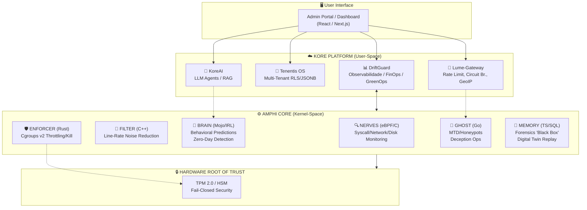
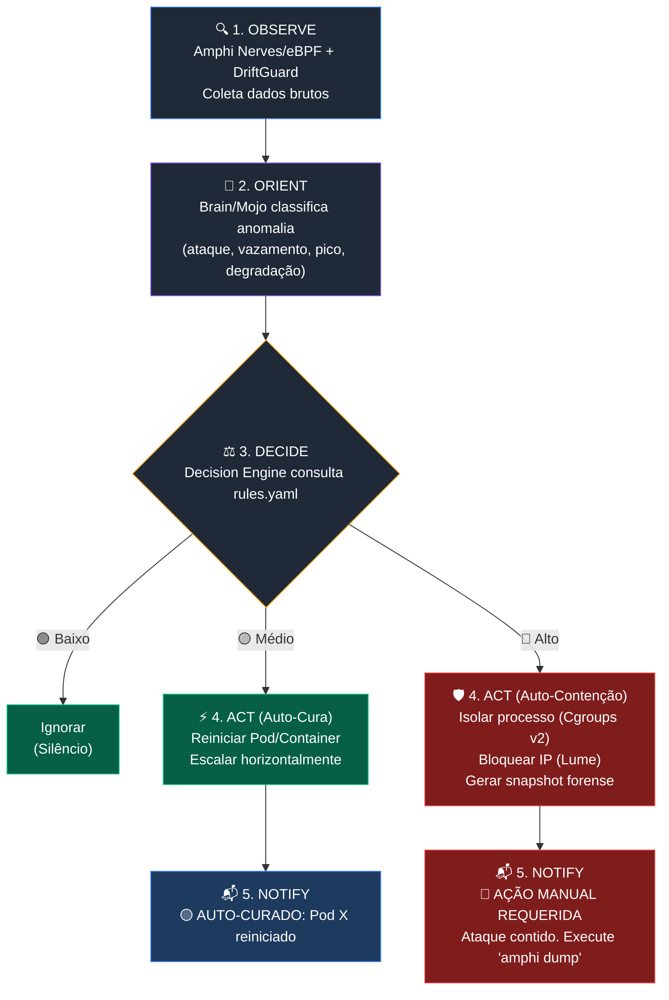

# 🛡️ Amphi: The Black Box

> **The Autonomous Immune System for Critical Infrastructures | O Sistema Imunológico Autônomo para Infraestruturas Críticas**

<p align="center">
  
</p>


---

## 📑 Índice (Table of Contents)
1. [📖 A Visão (The Vision)](#-a-visão-the-vision)
2. [⚙️ Pré-requisitos (Prerequisites)](#️-pré-requisitos)
3. [🗺️ Startup Roadmap / Roadmap de Desenvolvimento](#️-startup-roadmap--roadmap-de-desenvolvimento)
4. [🏛️ Detalhamento da Arquitetura (Deep Dive - Os 7 Órgãos)](#️-detalhamento-da-arquitetura-deep-dive)
5. [🔬 Tecnologias Avançadas & Submódulos](#-tecnologias-avançadas)
6. [🛡️ Integração: Amphi + MorphBPF (Hardware-Agnostic Defense)](#️-integração-amphi--morphbpf-hardware-agnostic-defense)
7. [🐕 Cerberus-Core — Amphi Ecosystem](#-cerberus-core--amphi-ecosystem)
8. [💎 AmphiLang: The Vertical Engine](#-amphilang-the-vertical-engine--o-motor-vertical)
9. [🧠 Human-in-the-Loop: The Glass Box Philosophy](#-human-in-the-loop-the-glass-box-philosophy)
10. [💻 Ecossistema de CLI & Ciclo de Vida Operacional](#-amphi-cli-ecosystem--ecossistema-de-cli-amphi)
11. [🧬 Inteligência em Enxame & Casos de Uso](#-inteligência-em-enxame-swarm-intelligence)
12. [⚖️ Architectural Risks & Mitigations / Riscos e Mitigações](#️-architectural-risks--mitigations--riscos-arquiteturais-e-mitigações)
---

## 📖 A Origem e a Visão (The Vision)

### 💡 The Origin & Vision | A Origem e a Visão

* **[EN] The Origin Story:** The idea for Amphi was born from the observation of a paradox: our digital systems are the backbone of modern civilization, yet they remain incredibly fragile. Traditional security is static, relying on walls that are perpetually bypassed by AI-driven threats. I realized that if we want to secure the future, we must stop building "walls" and start growing "organisms."
* **[PT-BR] A Origem da Ideia:** A ideia do Amphi nasceu da observação de um paradoxo: nossos sistemas digitais são a espinha dorsal da civilização moderna, mas permanecem incrivelmente frágeis. A segurança tradicional é estática, baseada em muros que são perpetuamente contornados por ameaças movidas por IA. Percebi que, se queremos proteger o futuro, precisamos parar de construir "muros" e começar a cultivar "organismos".

### 🧬 Why the Name "Amphi"? | Por que o nome "Amphi"?

* **[EN] The Meaning:** The name is derived from the prefix "Amphi-" (from Ancient Greek *amphi*), meaning "both," "on both sides," or "surrounding."
* **Bio-mimicry:** It represents an Amphibian nature—the ability to adapt and survive in two different environments: the User-Space (where applications run) and the Kernel-Space (where the system breathes).
* **Security:** Like an amphibian that thrives in water and on land, Amphi thrives within the deep kernel and the high-level network topology, providing "surrounding" protection that is both internal and external.


* **[PT-BR] O Significado:** O nome deriva do prefixo "Amphi-" (do grego antigo *amphi*), que significa "ambos", "de ambos os lados" ou "ao redor".
* **Bio-mimetismo:** Representa uma natureza Anfíbia — a capacidade de se adaptar e sobreviver em dois ambientes distintos: o User-Space (onde as aplicações rodam) e o Kernel-Space (onde o sistema respira).
* **Segurança:** Assim como um anfíbio que prospera na água e na terra, o Amphi prospera nas profundezas do kernel e na topologia de rede de alto nível, fornecendo uma proteção "ao redor" que é, simultaneamente, interna e externa.


### 🧠 Why This Architecture? | Por que esta arquitetura?

* **[EN] The Concept:** Most security solutions are reactive (they wait for an attack signature). Amphi is proactive and cognitive. By using **eBPF**, we gain an "omnipresent view" of the system without performance loss. By using **Mojo**, we achieve the speed of C with the intelligence of modern AI, allowing the system to learn the difference between a "normal user" and a "malicious threat" in real-time.
* **[PT-BR] O Conceito:** A maioria das soluções de segurança é reativa (esperam por uma assinatura de ataque). O Amphi é proativo e cognitivo. Ao usar **eBPF**, ganhamos uma "visão onipresente" do sistema sem perda de performance. Ao usar **Mojo**, alcançamos a velocidade de C com a inteligência da IA moderna, permitindo que o sistema aprenda a diferença entre um "usuário normal" e uma "ameaça maliciosa" em tempo real.

### 💼 Market Value | Valor de Mercado

* **[EN]** This roadmap transforms Amphi from a simple "Antivirus" into an Autonomous Security Analyst, drastically reducing operational costs (OpEx) for SOC teams and meeting the highest global regulatory standards (NIS2, GDPR, SOX).
* **[PT-BR]** Este roadmap transforma o Amphi de um simples "Antivírus" em um Analista de Segurança Autônomo, reduzindo drasticamente os custos operacionais (OpEx) de equipes de SOC e atendendo aos mais altos padrões regulatórios globais (NIS2, GDPR, SOX).

### 🚀 Competitive Positioning | Posicionamento Competitivo

Amphi transcends traditional security by shifting from reactive detection to **Cognitive Intent Analysis** and **Hardened Autonomy**. O Amphi transcende a segurança tradicional, migrando da detecção reativa para a Análise Cognitiva de Intenção e Autonomia Blindada.

* **Brain (Mojo) - From Detection to Intent / Da Detecção à Intenção:**
* **[EN]** By utilizing Inverse Reinforcement Learning (IRL), the Brain doesn't just identify "what" a process is doing; it predicts "why" it is doing it. By forecasting an adversary’s next three moves, Amphi intercepts attacks before they fully manifest.
* **[PT-BR]** Utilizando Aprendizado por Reforço Inverso (IRL), o Brain não apenas identifica "o que" um processo está fazendo; ele prevê o "porquê". Ao antecipar os próximos três passos de um adversário, o Amphi intercepta ataques antes que eles se concretizem.


* **Fail-Closed - Mathematical Integrity / Integridade Matemática:**
* **[EN]** We move beyond logic to physical security by anchoring our Fail-Closed mechanism to Hardware Root of Trust (TPM 2.0/HSM). If the Amphi agent is tampered with, the system triggers a hardware-level lock, rendering the node unreachable to unauthorized entities.
* **[PT-BR]** Elevamos a segurança da lógica para o hardware, ancorando nosso mecanismo Fail-Closed em uma Raiz de Confiança por Hardware (TPM 2.0/HSM). Caso o agente Amphi seja adulterado, o sistema aciona um travamento em nível de hardware, tornando o nó inacessível para entidades não autorizadas.


---

## ⚙️ Pré-requisitos

Como o Amphi opera no nível mais profundo do sistema operacional, o ambiente hospedeiro precisa atender a alguns requisitos mínimos:

* **OS:** Linux (Arch Linux, Ubuntu 22.04+, ou qualquer distribuição com suporte nativo a eBPF)
* **Kernel:** Linux Kernel versão 5.8 ou superior (necessário para os hooks avançados do eBPF).
* **Dependências de Build:**
* Rust (`cargo` e `rustc` 1.70+)
* Go (1.20+)
* Clang/LLVM (para compilar os programas eBPF em C)
* Node.js / TypeScript (para a engine do Memory/Forensics)
* Python (3.10+)


---

## 🗺️ Startup Roadmap / Roadmap de Desenvolvimento

| Stage | Focus | Objective |
| --- | --- | --- |
| **Phase 1 (MVP)** | **eBPF Observability** | Sell "Amphi Insight": total visibility with zero latency. |
| **Phase 2 (Scale)** | **Rust Enforcer** | Add autonomous containment capabilities via Cgroups. |
| **Phase 3 (Cognitive)** | **Mojo Brain** | Deliver proactive behavioral Zero-Day detection. |
| **Phase 4 (Federated)** | **Swarm Intelligence** | Monetize collective defense through ecosystem-wide learning. |

---

## 🏛️ Detalhamento da Arquitetura (Deep Dive)

O Amphi funciona como um organismo composto por sete especializações tecnológicas (órgãos), cada uma focada em uma função crítica de sobrevivência:

1. **Nerves (eBPF / C) – A Percepção**
* **Função:** Monitoramento ininterrupto de eventos de kernel (Syscalls, Networking, Disk I/O).
* **Por que:** É a única forma de obter visibilidade total sem injetar latência. O eBPF permite que o Amphi "sinta" o que está acontecendo sem que o invasor consiga mascarar sua presença através de bibliotecas de usuário (user-space hooks).


2. **Filter (C++) – O Sistema Límbico**
* **Função:** Processamento de sinais brutos e redução de ruído.
* **Por que:** O kernel gera milhões de eventos por segundo. O C++ é o "filtro" que descarta o tráfego legítimo (ruído) e passa apenas as anomalias relevantes para a IA. É a camada de alta performance que garante que o "cérebro" não sofra sobrecarga.


3. **Brain (Mojo) – A Cognição Adaptativa**
* **Função:** Inferência preditiva baseada em comportamento (Behavioral Analysis).
* **Por que:** Diferente de firewalls que buscam por "assinaturas de vírus" (conhecimento passado), o motor Mojo analisa a intenção (conhecimento presente). Se um processo começa a ler arquivos de sistema que nunca acessou, o Mojo classifica aquilo como anomalia de comportamento, detectando ataques Zero-Day que nenhuma lista de bloqueio conseguiria prever.


4. **Enforcer (Rust) – A Resposta Imunológica**
* **Função:** Isolamento, bloqueio e mitigação.
* **Por que:** Em uma emergência, falhas de software são inaceitáveis. O Rust garante que as ações de defesa (kill, block, isolate) sejam executadas com Memory Safety. O sistema de defesa nunca derrubará o servidor por um erro de segmentação (Memory Leak/Segmentation Fault).


5. **Memory (TS / SQL) – O Registro Forense (The Black Box)**
* **Função:** Armazenamento de estado, reconstrução de incidentes e análise histórica.
* **Por que:** Esta é a "Caixa-Preta" do avião. Ela não apenas grava logs; ela armazena snapshots de memória e o contexto completo da rede no momento da invasão. Isso permite o *Digital Twin Playback*: você pode simular a invasão novamente em ambiente fechado para estudar o exploit.


6. **Ghost (Go / Envoy) – A Decepção Estratégica (MTD)**
* **Função:** Moving Target Defense (MTD) e Honeypots dinâmicos.
* **Por que:** A melhor defesa é fazer o atacante perder tempo. O Amphi rotaciona portas e rotas de serviço dinamicamente. O atacante acha que está explorando um alvo, mas está sendo guiado para uma armadilha (Sandbox), enquanto o serviço real está "em outro lugar" na topologia da rede.


7. **Orchestrator (Python) – O Sistema Nervoso Central**
* **Função:** Agregação de telemetria, injeção dinâmica de políticas, controle de automação e integração externa (Glue-Code).
* **Por que:** Enquanto Rust e C/eBPF controlam os "reflexos" mecânicos e instantâneos do sistema, o Python opera como a mente consciente para gerenciamento estratégico. Ele unifica os órgãos do Amphi, facilitando a automação de ferramentas forenses, orquestração do Modo Caos e integração nativa com SIEMs (Splunk, ELK) e APIs de nuvem sem comprometer o caminho crítico de baixa latência.


---

### 🔬 Tecnologias Avançadas

#### 🌐 Encrypted Traffic Vision | Visão de Tráfego Encriptado

* **[EN]** Modern ransomware and data exfiltration malware heavily leverage TLS 1.3 or QUIC protocols, rendering traditional kernel-space eBPF inspection (XDP/TC) blind to the encrypted payloads. To bypass this limitation, the Nerves module implements user-space dynamic tracing via uprobes and uretprobes. By anchoring directly into the runtime memory of cryptographic libraries like OpenSSL and BoringSSL (specifically targeting `SSL_read` and `SSL_write`), Amphi intercepts and reads the raw plaintext payload a millisecond before encryption occurs and the packet hits the network interface. This achieves 100% visibility into malicious payloads without the overhead of a decryption proxy or the need to break mutual TLS (mTLS).
* **[PT-BR]** Ransomwares modernos e malwares de exfiltração utilizam intensamente os protocolos TLS 1.3 ou QUIC, tornando a inspeção tradicional de eBPF no kernel-space (XDP/TC) cega para pacotes criptografados. Para superar essa limitação, o módulo Nerves implementa rastreamento dinâmico em user-space via uprobes e uretprobes. Ao ancorar-se diretamente na memória de execução de bibliotecas criptográficas como OpenSSL e BoringSSL (visando especificamente as funções `SSL_read` e `SSL_write`), o Amphi intercepta e lê o payload em texto plano um milissegundo antes da criptografia acontecer e o pacote ser enviado para a interface de rede. Isso garante visibilidade total contra tráfego malicioso sem o overhead de um proxy de interceptação ou a necessidade de quebrar o mTLS.

#### ⏳ Micro-Segmentation & Throttling | Micro-segmentação e Estrangulamento

* **[EN]** Immediately terminating a compromised process (`SIGKILL`) alerts an advanced adversary that their presence has been discovered, triggering automated evasion or anti-forensics measures. The Enforcer module addresses this by leveraging Linux Cgroups v2 for silent, dynamic throttling. Instead of killing or freezing the thread, the Rust agent seamlessly migrates the malicious process into a highly restricted, isolated cgroup namespace. Here, it slashes the process's CPU quota (e.g., down to 1%) and heavily constrains its disk I/O bandwidth (IOPS). The malware continues executing, but at such an agonizingly slow velocity that a ransomware attack that would normally destroy a disk in seconds now takes years to complete, buying infinite time for the forensics engine to capture live memory states.
* **[PT-BR]** Matar imediatamente um processo comprometido (`SIGKILL`) alerta um adversário avançado de que sua presença foi descoberta, disparando contramedidas automatizadas de evasão ou anti-forense. O módulo Enforcer resolve isso utilizando o Cgroups v2 do Linux para realizar um estrangulamento silencioso e dinâmico. Em vez de derrubar ou congelar a thread, o agente em Rust migra perfeitamente o processo malicioso para um namespace isolado e altamente restrito do cgroup. Nele, o sistema corta a cota de CPU do processo (ex: para 1%) e restringe severamente a banda de I/O de disco (IOPS). O malware continua rodando, mas a uma velocidade tão ínfima que um ataque de ransomware que destruiria o disco em segundos passa a levar anos, garantindo tempo infinito para o motor forense capturar estados de memória viva.

#### ⚡ Side-Channel & Hardware Monitoring | Monitoramento de Side-Channel por Hardware

* **[EN]** Highly sophisticated exploits (such as Spectre, Meltdown, or stealthy, low-footprint cryptominers) often leave no footprints in traditional network connections or standard disk I/O syscalls. To detect these microscopic vectors, Amphi bridges its eBPF subsystem with the Linux `perf_events` API to continuously sample Hardware Performance Counters (PMCs) directly from the CPU. The system monitors core microarchitectural metrics including L1/L2/L3 Cache Misses, Branch Prediction Failures, and Instructions Per Cycle (IPC) anomalies. If a seemingly benign or legitimate user-space application begins to induce rhythmic cache misses or abnormal branch mispredictions, the Brain (Mojo) immediately correlates the hardware telemetry to isolate the hardware side-channel attack in real-time.
* **[PT-BR]** Exploits extremamente sofisticados (como Spectre, Meltdown ou cryptominers furtivos de baixo consumo) frequentemente não deixam pegadas em conexões de rede ou chamadas de sistema padrão de I/O de disco. Para detectar esses vetores microscópicos, o Amphi conecta seu subsistema eBPF com a API `perf_events` do Linux para amostrar continuamente os Hardware Performance Counters (PMCs) diretamente da CPU. O sistema monitora métricas microarquiteturais críticas, incluindo Cache Misses (L1/L2/L3), falhas de predição de desvio (Branch Prediction Failures) e anomalias de Instruções por Ciclo (IPC). Se uma aplicação aparentemente legítima em user-space começa a induzir falhas rítmicas de cache ou desvios anômalos, o Brain (Mojo) correlaciona a telemetria de hardware para isolar o ataque de canal lateral em tempo real.

#### 🛡️ Swarm Differential Privacy | Privacidade Diferencial no Enxame

* **[EN]** When sharing behavioral threat signatures ("vaccines") across the Federated Swarm Ecosystem, there is an inherent risk of accidentally leaking sensitive application runtime data, memory configurations, or payload fragments from the initially targeted server. Amphi mitigates this privacy vector by executing a localized Differential Privacy (DP) mathematical algorithm before broadcasting any telemetry to the cluster. The node injects calculated statistical noise into the threat vector, mathematically masking any Personally Identifiable Information (PII), keys, or confidential customer data. This ensures that while the exact, unique cryptographic and behavioral pattern of the malware is perfectly preserved for collective defense, the host node identity and context remain completely unrecoverable, fulfilling strict Zero-Trust compliance.
* **[PT-BR]** Ao compartilhar vacinas comportamentais contra ameaças (assinaturas de ataque) por todo o Ecossistema Federado, existe o risco inerente de vazar acidentalmente dados sensíveis de execução, configurações de memória ou fragmentos de payload do servidor inicialmente atacado. O Amphi mitiga esse vetor de privacidade executando um algoritmo matemático de Privacidade Diferencial (DP) local antes de transmitir qualquer telemetria ao cluster. O nó injeta um ruído estatístico calculado no vetor da ameaça, mascarando matematicamente qualquer Informação de Identificação Pessoal (PII), chaves ou dados confidenciais do cliente. Isso garante que, enquanto o padrão comportamental e criptográfico exato do malware é preservado para a defesa coletiva, o contexto e a identidade do nó de origem permanecem irrecuperáveis, cumprindo regras estritas de conformidade Zero-Trust.

#### 🧪 Continuous Auto-Audit (Chaos Mode) | Auto-Auditoria Contínua (Modo Caos)

* **[EN]** To guarantee that the system's autonomous immunological defenses remain functional and un-tampered during prolonged operational periods without real-world security incidents, Amphi introduces a continuous Chaos Engineering submodule. During designated low-traffic, low-risk infrastructure windows, this module safely injects non-destructive, synthetic pseudo-malware processes into the runtime environment. These automated agents attempt to simulate common adversarial actions, such as reading restricted system configurations or spawning unauthorized reverse shells. This continuously tests if the eBPF kernel hooks, user-space uprobes, and Ghost (MTD) deceptive honey-ports are active and responsive, generating a real-time "Immunological Health Score" directly on the central dashboard.
* **[PT-BR]** Para garantir que as defesas imunológicas autônomas do sistema permaneçam totalmente operacionais e invioladas durante longos períodos operacionais sem incidentes reais de segurança, o Amphi introduz um submódulo contínuo de Chaos Engineering. Durante janelas designadas de baixo tráfego e baixo risco na infraestrutura, este módulo injeta de forma segura processos sintéticos não-destrutivos (pseudomalwares) no ambiente de runtime. Esses agentes automatizados tentam simular ações adversárias comuns, como a leitura de configurações restritas do sistema ou a criação de shells reversas não autorizadas. Isso testa continuamente se os hooks de eBPF no kernel, as uprobes em user-space e as portas falsas do Ghost (MTD) estão ativos e responsivos, gerando um "Score de Saúde Imunológica" em tempo real diretamente no dashboard central.

---

## 🛡️ Casos de Uso na Prática (The Amphi in Action)

* **Ransomware Zero-Day:** Um ransomware desconhecido tenta encriptar o disco. O Brain (Mojo) detecta uma anomalia na taxa de IOPS e syscalls de escrita não naturais. O Enforcer (Rust) congela o processo em microssegundos antes que o primeiro arquivo seja corrompido.
* **Vazamento de Dados (Exfiltration):** Um atacante compromete uma aplicação web e tenta enviar dados para um IP na Rússia. O Nerves (eBPF) detecta o socket anômalo. O Ghost (Go/Envoy) intercepta a conexão e redireciona o tráfego do atacante para um Honeypot, fazendo-o acreditar que o download está acontecendo, enquanto o time de segurança é alertado.

---

## 🛡️ Amphi: Ciclo de Vida Operacional e Controle

*(Operational Lifecycle & Control)*

### 1. Initialization Workflow | Fluxo de Inicialização (`amphi start`)

* **[EN]** When you execute `amphi start`, the system executes three security layers in milliseconds:
* **Bootstrapping (Integrity Check):** Verifies kernel flags for eBPF and ensures required modules (`bpf_prog`) can be loaded.
* **Data Plane Injection:** The Rust agent injects compiled `.o` (eBPF) objects directly into kernel hooks (XDP for network, Tracepoints for syscalls).
* **Swarm Synchronization:** Connects your node to the Federated Ecosystem to fetch the latest "vaccines" (security patterns).


* **[PT-BR]** Quando você executa `amphi start`, o sistema executa três camadas de segurança em milissegundos:
* **Bootstrapping (Verificação de Integridade):** Verifica as flags do Kernel para eBPF e garante que os módulos necessários (`bpf_prog`) possam ser carregados.
* **Injeção do Data Plane:** O agente em Rust injeta os objetos compilados `.o` (eBPF) diretamente nos hooks do kernel (XDP para rede, Tracepoints para syscalls).
* **Sincronização do Enxame:** Conecta seu nó ao Ecossistema Federado para buscar as "vacinas" (padrões de segurança) mais recentes.


### 2. Cluster Connectivity | Conectividade de Cluster (`amphi connect`)

Transforms an isolated server into a Collective Intelligence Node. / Transforma um servidor isolado em um Nó de Inteligência Coletiva.

* **Authentication:** Uses mutual TLS (mTLS) to secure communication with the cluster or private dashboard. / Utiliza mTLS (Mutual TLS) para garantir uma comunicação segura com o cluster ou painel de controle privado.
* **Heartbeat:** Establishes a constant telemetry channel, sending full exploit context, not just raw logs. / Estabelece um canal de telemetria constante, enviando o contexto completo do exploit, não apenas logs brutos.

### 3. Operational States | Estados Operacionais

Because Amphi is active kernel-level security, stopping it requires specific states to maintain system integrity. / Como o Amphi é uma segurança ativa ao nível do Kernel, parar o sistema exige estados específicos para manter a integridade do sistema.

| Command | Kernel State (eBPF) | AI State (Brain) | Logs (Black Box) |
| --- | --- | --- | --- |
| `pause` | Active (Monitoring) | Disabled | Active (Logging) |
| `stop` | Detached (Removed) | Disabled | Inactive |
| `shutdown` | Removed + Cleaned | Disabled | Removed |

**Definitions | Definições:**

* `amphi pause`: Use for maintenance (e.g., patching). It stops blocking/analysis but keeps monitoring active. / Use para manutenção (ex: atualizar o sistema). Interrompe bloqueios e análises, mas mantém o monitoramento passivo.
* `amphi stop`: Shuts down the agent and detaches all BPF probes. / Encerra o agente e desanexa todas as sondas BPF.
* `amphi shutdown`: Total de-installation. Clears all BPF Maps and forensics cache. Requires secondary authentication if auto-repair is active. / Desinstalação total. Limpa todos os BPF Maps e o cache forense. Exige autenticação secundária se o auto-reparo estiver ativo.

---

## 💻 Amphi CLI Ecosystem / Ecossistema de CLI Amphi

### 1. Vital Signs / Sinais Vitais e Diagnóstico

Real-time health metrics to ensure the system runtime is coherent and un-tampered. / Métricas de saúde em tempo real para garantir que a execução do sistema esteja coerente e livre de adulterações.

* `amphi status`: Returns a high-level telemetry dashboard. (e.g., "Immunological Health: 98% | Blocked Threats: 4 | eBPF Hook Latency: 0.02ms"). / Retorna um dashboard rápido de telemetria.
* `amphi pulse`: Cryptographically verifies the real-time heartbeat synchronization between the user-space agent and low-level kernel hooks. / Verifica criptograficamente a sincronização do batimento cardíaco entre o agente em user-space e os hooks no kernel.
* `amphi audit`: Compiles a structural report of recent system modifications and historical blocks ("scar logs"), designed for strict compliance audits. / Compila um relatório estrutural de modificações recentes no sistema e históricos de bloqueio ("logs de cicatrizes").

### 2. Immune Response / Resposta Imunológica Ativa

Manual overrides to force behavioral containment and collective swarm updates. / Substituições manuais para forçar a contenção comportamental e atualizações coletivas do enxame.

* `amphi vaccinate <threat_id>`: Forces the immediate pull of a specific threat signature vector from the cluster network or broadcasts a locally generated threat profile to the Federated Swarm. / Força o download imediato ou transmite um perfil de ameaça para o Enxame Federado.
* `amphi isolate <PID>`: Direct manual intervention. Instantly migrates a suspicious Process ID into the highly constrained, throttled Linux Cgroups v2 sandbox namespace. / Intervenção manual direta. Migra instantaneamente um PID suspeito para o namespace isolado do Cgroups v2.
* `amphi simulate <type>`: Triggers the continuous Chaos Engineering submodule manually to test specific active defense vectors (e.g., `amphi simulate ransomware` or `amphi simulate ddos`). / Ativa o submódulo de Chaos Engineering de forma manual para testar vetores de defesa.

### 3. Nervous System / Configuração e Políticas (System Overlays)

Fine-tuning adaptive operational modes without disrupting critical data-plane traffic. / Ajuste fino de modos operacionais adaptativos sem interromper o tráfego crítico.

* `amphi config --reload`: Dynamically reloads the `amphi.yaml` rules manifest with absolute zero downtime, updating active filter meshes instantly. / Recarrega dinamicamente as regras com zero downtime.
* `amphi swarm-join <token>`: Authenticates and binds the current node into the local or global cluster, enabling decentralized P2P threat vector updates. / Autentica e vincula o nó atual ao cluster, habilitando atualizações P2P.
* `amphi policy --set <mode>`: Shifts global defense logic behavior profile / Alterna o perfil global de defesa:
* **paranoid**: Maximum enforcement. Immediate isolation and lock on any micro-architectural or network anomaly. / Execução máxima. Isolamento imediato.
* **balanced**: Standard behavioral operation. Mitigation triggers rely on high-confidence Mojo AI classification score. / Operação padrão baseada em IA de alta confiança.
* **learning**: Passive observation mesh. Tracks anomalies, registers logs, but strictly drops blocking actions. / Observação passiva, rastreia mas não bloqueia.


### 4. Forensics / Investigação da Caixa-Preta (Black Box)

Extracting contextual infrastructure footprints following a targeted malicious incident. / Extração de pegadas contextuais após um incidente.

* `amphi dump <incident_id>`: Exports a highly secure, isolated execution memory snapshot and the historical network state captured at the exact microsecond of the breach. / Exporta snapshot isolado de memória e estado de rede do momento exato da invasão.
* `amphi replay <incident_id>`: Spawns a secure Digital Twin sandbox topology to replay the recorded exploit footprint, mapping out precise adversarial methods. / Cria Gêmeo Digital (Digital Twin) seguro para reproduzir o exploit gravado.

### 5. Command Matrix Summary / Resumo Estruturado de Comandos

| Category / Categoria | Command / Comando | Action (EN) | Ação (PT-BR) |
| --- | --- | --- | --- |
| **Status** | `amphi status` | Real-time node structural telemetry & health scoreboard. | Telemetria estrutural e score de saúde do nó em tempo real. |
| **Control** | `amphi policy` | Dynamically alters active runtime enforcement logic (learning, balanced, paranoid). | Altera dinamicamente as regras de execução ativa em runtime. |
| **Response** | `amphi isolate` | Forces immediate automated process migration into the containment cgroup. | Força a migração imediata de um processo para o cgroup de contenção. |
| **Swarm** | `amphi vaccinate` | Syncs behavioral vaccine profiles and rules across the decentralized P2P cluster. | Sincroniza perfis de vacinas comportamentais com o cluster P2P descentralizado. |
| **Forensics** | `amphi dump` | Extracts secure memory snapshot and historical network state at the breach microsecond. | Exporta um snapshot de memória e o estado histórico da rede no microssegundo da invasão. |

> ⚠️ **Engineering Note | Nota de Engenharia**
> **[EN]** Implement a systemd watchdog. If Amphi is stopped without authorization or terminated by malware, the system should trigger a Fail-Closed (network lock) and alert the central dashboard.
> **[PT-BR]** Implemente um systemd watchdog. Se o Amphi for parado sem autorização ou finalizado por malware, o sistema deve acionar um Fail-Closed (travamento de rede) e alertar o painel central imediatamente.

---

## 🧬 Inteligência em Enxame (Swarm Intelligence)

O Amphi não é apenas local; ele é um Ecossistema Federado.

* **Aprendizado Federado:** Cada nó (servidor) é um estudante. Quando o nó A aprende que uma sequência de pacotes específica é um ataque, ele cria uma "vacina" (um vetor de detecção). Essa vacina é compartilhada via protocolo de rede com todos os outros nós do cluster.
* **Imunidade de Rebanho:** Uma ameaça detectada em um servidor da ponta torna todo o seu Data Center imune a ela em segundos. O atacante nunca terá sucesso duas vezes.
* **Auto-Reparação (Self-Healing):** Se o Amphi detecta um processo comprometido, ele não apenas bloqueia; ele rotaciona segredos (API Keys, tokens), reinicia os contêineres a partir de uma imagem limpa e notifica o painel central, tudo isso sem intervenção humana.

---

## ⚖️ Architectural Risks & Mitigations | Riscos Arquiteturais e Mitigações

### 1. "Security by Excess" Risk (Kernel Instability) | O Risco de "Segurança por Excesso" (Instabilidade do Kernel)

* **[EN] Risk:** Operating deep within kernel-space using eBPF hooks poses a theoretical risk of causing a Kernel Panic (completely crashing the system) if logic errors, unauthorized memory access, or infinite loops occur in the `bpf_prog`.
* **Mitigation:** Amphi builds completely upon the mathematical guarantees of the Linux platform's native BPF Verifier. Before any code is loaded into the kernel, the verifier acts as a strict static analyzer that completely rejects unsafe memory paths, uninitialized variables, or unbounded loops, making runtime kernel crashes structurally impossible.


* **[PT-BR] Risco:** O uso de eBPF e hooks no Kernel pode causar um Kernel Panic (o sistema trava completamente) se o seu código tiver um erro de lógica, acesso indevido à memória ou um laço infinito no `bpf_prog`.
* **Mitigação:** O Amphi é construído totalmente sobre as garantias matemáticas do BPF Verifier nativo da plataforma Linux. Antes que qualquer código seja carregado no kernel, o verificador impede que código inseguro ou que possa travar o sistema seja inserido, garantindo a estabilidade operacional da própria plataforma.


### 2. Performance Overhead (Latency vs. Protection) | Overhead de Performance (Latência vs. Proteção)

* **[EN] Risk:** Even though eBPF runs at near-native hardware speed, continuous monitoring of intensive system-wide syscalls and heavy user-space uprobe tracing on cryptographic libraries (like OpenSSL) can degrade host application performance under maximum throughput conditions.
* **Mitigation:** The C++ Filter module is designed exactly as an ultra-fast triage layer to eliminate noise at line-rate. Only telemetry that passes this localized pre-classification is offloaded to the complex AI engine (Mojo), keeping the main execution hot-path overhead effectively close to zero.


* **[PT-BR] Risco:** Embora o eBPF seja extremamente rápido, o monitoramento constante de syscalls, especialmente com inspeção de uprobes em bibliotecas criptográficas (OpenSSL), pode degradar a performance da aplicação hospedeira sob carga pesada.
* **Mitigação:** O módulo Filter (C++) serve exatamente para isso: realizar o descarte rápido de ruído. Apenas eventos anômalos que passaram por esse filtro de pré-classificação ultrarrápido são enviados para a análise pesada da IA (Mojo), mantendo o overhead geral próximo de zero.


### 3. "False Positive" Risk (Business Disruption) | Risco de "Falso Positivo" (O Bloqueador de Negócio)

* **[EN] Risk:** If the behavioral AI engine (Brain/Mojo) mistakenly flags a legitimate massive system update or an unexpected business sales traffic spike as an active zero-day exploit, it could prematurely terminate or isolate critical infrastructure services.
* **Mitigation:** The lifecycle enforces a non-blocking "Observation Mode" (passive monitoring) before moving into active enforcement. Furthermore, the core manifest implements strict "Fail-Safe" logic boundaries where, if the AI's classification confidence falls below a safe **threshold, the system defaults to generating high-priority alerts for manual review rather than initiating automated containment blocks.**


* **[PT-BR] Risco:** Se a IA comportamental (Brain/Mojo) marcar erroneamente uma atualização massiva de sistema ou um pico de tráfego de vendas como um exploit zero-day, ela pode isolar ou derrubar prematuramente serviços críticos de infraestrutura.
* **Mitigação:** O ciclo de vida impõe um "Modo de Observação" (monitoramento passivo) sem bloqueio antes de passar para a execução ativa. Além disso, o manifesto principal implementa limites lógicos estritos de "Fail-Safe" onde, se a confiança de classificação da IA cair abaixo de um limite seguro, **o sistema gera alertas de alta prioridade para analistas humanos em vez de executar bloqueios automatizados.**


---

# 🐕 Cerberus-Core — Amphi Ecosystem

## 📌 O Significado do Nome: O Guardião do Kernel | The Kernel Guardian

### [PT-BR]
Na mitologia grega, Cérbero (Cerberus) é o monstruoso cão de três cabeças que guarda os portões do submundo, garantindo que ninguém entre sem permissão e ninguém escape. No ecossistema Amphi, o Cerberus-Core assume exatamente essa função. Ele atua como o cão de guarda supremo e inabalável do Kernel do Sistema Operacional. Suas três cabeças representam as três dimensões analíticas que ele monitora simultaneamente, criando uma "prisão triangular" para qualquer ameaça:
* **Primeira Cabeça (Rede/Lógica):** Vigia o estado e o contexto dos fluxos de dados.
* **Segunda Cabeça (CPU/Física):** Vigia o comportamento e o estresse do hardware em nível de silício.
* **Terceira Cabeça (Memória/Imunidade):** Vigia a integridade interna para garantir que a própria defesa nunca seja corrompida.

### [EN]
In Greek mythology, Cerberus is the monstrous three-headed hound that guards the gates of the underworld, ensuring no one enters without permission and no one escapes. Within the Amphi ecosystem, Cerberus-Core serves exactly this purpose. It acts as the ultimate, unyielding watchdog of the Operating System Kernel. Its three heads represent the three analytical dimensions it continuously monitors, establishing a "triangular prison" for any threat:
* **First Head (Network/Logic):** Watches the state and context of data flows.
* **Second Head (CPU/Physics):** Watches the behavior and stress of hardware at the silicon level.
* **Third Head (Memory/Immunity):** Watches internal integrity to ensure the defense itself is never compromised.

---

## ⚙️ Arquitetura Interna: Como as Três Cabeças Funcionam | Internal Architecture

O Cerberus-Core não é apenas um filtro; é um organismo autônomo. Ele opera cruzando telemetria de três submódulos críticos que vivem entre o *kernel-space* e o *user-space*:

### 1. `flow_state` (Rastreamento de Estado - A Rede | Stateful Tracking - The Network)
* **[PT-BR]** O eBPF tradicional é *stateless* (analisa pacotes isolados). O Cerberus resolve isso injetando mapas de alta performance (*Shared Maps*). Cada conexão ganha um ciclo de vida persistente, permitindo que o Amphi identifique ataques fracionados em milhares de pacotes e exfiltrações "*low-and-slow*".
* **[EN]** Traditional eBPF is stateless. Cerberus overcomes this by injecting high-performance memory structures (Shared Maps). Every connection is given a persistent lifecycle, allowing Amphi to piece together fragmented exploits and detect "low-and-slow" exfiltration attempts.

### 2. `hardware_pmu` (Inspeção de Canal Lateral - A CPU | Side-Channel Inspection - The CPU)
* **[PT-BR]** Malwares modernos ofuscam código para burlar assinaturas. O Cerberus ignora a assinatura e foca na física. Através dos PMCs (*Performance Monitoring Counters*), ele lê diretamente do processador. Se um *payload* ofuscado tentar se descompactar, ele gerará picos absurdos de *Cache-Misses* e *Branch Mispredictions*. A anomalia é pega antes da execução.
* **[EN]** Modern malware obfuscates code to evade signatures. Cerberus ignores the signature and focuses on physics. By reading the PMCs (Performance Monitoring Counters) directly from the processor, it detects when an obfuscated payload attempts to unpack itself, causing drastic spikes in Cache-Misses and Branch Mispredictions. The anomaly is caught before execution.

### 3. `self_guard` (Sentinela de Memória - A Autodefesa | Memory Sentinel - The Self-Defense)
* **[PT-BR]** Se o invasor tentar atacar a própria engine (via injeção de *heap* ou *buffer overflow*), o Cerberus se defende. Ele utiliza *Guard Pages* e validação criptográfica (HMAC) ao redor de suas tabelas e ponteiros. Qualquer escrita não autorizada resulta em bloqueio instantâneo do atacante.
* **[EN]** Should an attacker target the engine itself (via heap injection or buffer overflows), Cerberus strikes back. It surrounds its tables and pointers with Guard Pages and runtime cryptographic validation (HMAC). Any unauthorized write attempt instantly locks the attacker out.

---

## 💻 A Interface de Comando: O `cb` CLI | The Command Interface

Para gerenciar essa complexidade de nível de kernel, o Cerberus utiliza um protocolo de comandos DevOps de alta eficiência acionado pelo prefixo `cb`. Os comandos são gatilhos que atualizam os mapas eBPF e se comunicam assincronamente com o Orquestrador através de UNIX sockets:

* **`cb run`**: Inicia a engine. Executa a validação de privilégios (*root*), checa a assinatura dos binários, carrega as regras via MorphBPF para contornar problemas de hardware (*NIC offsets*) e acorda as três cabeças simultaneamente. / *Bootstraps the engine. Validates root privileges, checks signatures, loads rules via MorphBPF, and awakens all three heads.*
* **`cb status`**: Consulta os anéis de buffer (*Ring Buffers*) do kernel e devolve telemetria limpa e imediata (conexões rastreadas, estresse de CPU, integridade de memória). / *Queries the kernel's Ring Buffers and returns immediate telemetry.*
* **`cb watch`**: Abre uma visão em tempo real focada na identificação de anomalias (similar ao `htop`, mas voltado para caça de ameaças ativas). / *Opens a real-time monitoring view tailored for anomaly identification.*
* **`cb freeze <PID>`**: Comando de reflexo e contenção profunda. Não mata o processo (o que destruiria provas em memória), mas usa *Cgroups v2* para limitar a CPU do atacante a 1%, "congelando-o" para análise forense. / *A deep-containment reflex command. Throttles the attacker's CPU usage to 1% using Cgroups v2 instead of killing it.*

---

## 🕸️ Integração com o Amphi Inteiro / Integration

* **Entrada (MorphBPF):** Ajusta os pacotes independentemente de qual placa de rede (Intel, Mellanox) o servidor usa e os envia limpos ao `flow_state`.
* **Correlação (`cerberus_orchestrator`):** Avalia os dados em nanossegundos. Se a Rede for anômala E a CPU der picos de erros físicos = Ataque Confirmado.
* **Decisão Neural (Brain/Mojo):** Toda essa telemetria física e lógica alimenta os tensores do motor em Mojo. O Amphi usa isso para treinar sua Inteligência de Enxame via Aprendizado por Reforço Inverso (IRL), distribuindo a "vacina" para toda a rede antes que o ataque se repita.
* **Linguagens Dominantes:** Rust (80%) para segurança de memória nativa e orquestração assíncrona; C++ (20%) para acesso direto e de zero-latência às APIs de monitoramento físico do Linux (`perf_event_open`).

---

## 💎 AmphiLang: The Vertical Engine | O Motor Vertical

* **Verifier-Aware:** A linguagem garante matematicamente que o código gerado será aceito pelo *Kernel Verifier*. Chega de "tentativa e erro" no eBPF.
* **Stateful Security:** Monitoramento de fluxos de rede persistentes, identificando ataques lentos (*low-and-slow*) que firewalls comuns ignoram.
* **Performance Absoluta:** Compilação direta via MLIR para eBPF *Bytecode*, unindo abstração de alto nível com a brutalidade do silício.

---

## ⚙️ The Dual Nature: Language & Runtime | A Natureza Dual: Linguagem e Runtime

* **[PT-BR]** O Amphi funciona através da simbiose entre dois componentes que operam em camadas distintas:
  * **Como Linguagem (AmphiLang):** O nível de abstração (*Compiler Front-end*). Escreve-se lógica em sintaxe declarativa; o compilador MLIR garante que o programa seja livre de bugs de memória.
  * **Como Programa (Cerberus-Core):** O *Runtime* (*Execution Engine*). Binário em Rust de alta performance que carrega o bytecode, gerencia a IA (Mojo) e orquestra a mitigação.
* **[EN]** Amphi functions through the symbiosis of two components operating at distinct layers:
  * **As a Language (AmphiLang):** The abstraction layer (Compiler Front-end). Logic is written in declarative syntax; the MLIR compiler ensures the program is free of memory bugs.
  * **As a Program (Cerberus-Core):** The Runtime (Execution Engine). A high-performance Rust binary that loads the bytecode, manages the AI (Mojo), and orchestrates mitigation.


---


Aqui está. O **README COMPLETO E DEFINITIVO**. Ele une a **visão do "Nunca mais seja acordado às 3h"** com a **explicação técnica completa** do ecossistema Amphi/KORE Platform, mostrando como a auto-cura e a segurança autônoma funcionam na prática.

---

# 🛡️ Amphi / KORE Platform: The 3 AM Immune System
### *"Never be woken up at 3 AM by a false alarm again."* 
### *"Nunca mais seja acordado às 3h da manhã por um falso alarme."*

<div align="center">
  


**Stop configuring alerts. Start growing an immune system.**  
**Pare de configurar alertas. Comece a cultivar um sistema imunológico.**

</div>

---

## 📑 Table of Contents / Índice
- [🇧🇷 Português](#-português)
  - [O Problema: O Pânico das 3h da Manhã](#o-problema-o-pânico-das-3h-da-manhã)
  - [A Solução: Um Sistema Imunológico, Não um Pager](#a-solução-um-sistema-imunológico-não-um-pager)
  - [Arquitetura: Amphi é o Kernel, KORE é o Corpo](#arquitetura-amphi-é-o-kernel-kore-é-o-corpo)
  - [O Loop de Auto-Cura (OODA)](#o-loop-de-auto-cura-ooda)
  - [A Matriz de Decisão (Auto vs. Manual)](#a-matriz-de-decisão-auto-vs-manual)
  - [Componentes do Ecossistema](#componentes-do-ecossistema)
  - [Como Instalar](#como-instalar)
  - [A Promessa das 3h](#a-promessa-das-3h)
- [🇺🇸 English](#-english)
  - [The Problem: The 3 AM Panic](#the-problem-the-3-am-panic)
  - [The Solution: An Immune System, Not a Pager](#the-solution-an-immune-system-not-a-pager)
  - [Architecture: Amphi is the Kernel, KORE is the Body](#architecture-amphi-is-the-kernel-kore-is-the-body)
  - [The Self-Healing Loop (OODA)](#the-self-healing-loop-ooda)
  - [The Decision Matrix (Auto vs. Manual)](#the-decision-matrix-auto-vs-manual)
  - [Ecosystem Components](#ecosystem-components)
  - [How to Install](#how-to-install)
  - [The 3 AM Promise](#the-3-am-promise)

---

# 🇧🇷 Português

## O Problema: O Pânico das 3h da Manhã
Você conhece essa cena.

São 3h da manhã. Seu telefone vibra violentamente na cabeceira da cama. É o monitoramento. "ALERTA CRÍTICO: CPU acima de 90% no servidor de produção." Seu coração dispara. Você levanta cambaleando, abre o laptop com os olhos ardendo de sono, acessa o dashboard, e... o sistema já voltou ao normal. Foi um pico de 5 segundos. Ou um deploy mal feito que já foi rollbackado. Ou simplesmente um falso alarme.

**O problema não é a falha. O problema é a ineficiência do alerta.** Você perdeu o sono, perdeu a concentração no dia seguinte, perdeu a confiança na ferramenta e, pior de tudo: **perdeu a confiança em si mesmo** para resolver problemas reais quando eles aparecerem.

## A Solução: Um Sistema Imunológico, Não um Pager
O **Amphi / KORE Platform** não é mais uma ferramenta de monitoramento. É um **organismo digital autônomo**.

Ele não apenas "observa" e "avisa". Ele:
- **Observa** (no nível do Kernel, via eBPF).
- **Orienta** (entende se é um ataque, um pico normal ou um vazamento).
- **Decide** (baseado em regras que você define).
- **Age** (corrige o problema sozinho, em nanossegundos).
- **Notifica** (te avisa apenas quando você é realmente necessário).

**Se o sistema pode resolver sozinho, ele resolve e te manda uma mensagem de manhã.**  
**Se o sistema não pode resolver sozinho, ele contém o dano e te acorda com um relatório forense completo.**

Você não é mais um bombeiro. Você é um arquiteto.

## Arquitetura: Amphi é o Kernel, KORE é o Corpo
O **Amphi** é o Sistema Nervoso e Imunológico que reside dentro do Kernel do Linux. Ele enxerga cada chamada de sistema (syscall), cada pacote de rede, cada instrução do processador e cada mudança de estado da memória.

A **KORE Platform** é a camada funcional que vem **EMBUTIDA** dentro do Amphi. Ela é composta por módulos de alto nível que transformam o poder bruto do Kernel em serviços de negócio prontos para uso.

```
┌─────────────────────────────────────────────────────────────────────────────┐
│                    USER INTERFACE (React / Next.js)                         │
│                    Admin Portal & Monitoring Dashboard                      │
│  ┌───────────────────────────────────────────────────────────────────────┐  │
│  │                    KORE PLATFORM (User-Space Layer)                   │  │
│  │                  (Nativamente compilada no runtime do Amphi)          │  │
│  │  ┌───────────────┐  ┌───────────────┐  ┌───────────────────────────┐ │  │
│  │  │  KORE AI      │  │  TENENTIS OS  │  │  LUME-GATEWAY             │ │  │
│  │  │  LLM Agents   │  │  Multi-Tenant │  │  Rate Limit, Circuit Br.  │ │  │
│  │  │  RAG Pipeline │  │  RLS/JSONB    │  │  GeoIP, Auth              │ │  │
│  │  └───────────────┘  └───────────────┘  └───────────────────────────┘ │  │
│  │  ┌───────────────────────────────────────────────────────────────────┐│  │
│  │  │  DRIFTGUARD (Observabilidade Cognitiva / FinOps / GreenOps)       ││  │
│  │  └───────────────────────────────────────────────────────────────────┘│  │
│  └───────────────────────────────────────────────────────────────────────┘  │
│                                     │ (FFI / Zero-Copy IPC)                 │
│  ┌───────────────────────────────────────────────────────────────────────┐  │
│  │                    AMPHI CORE (Kernel-Space Layer)                    │  │
│  │                    O Sistema Imunológico Autônomo                     │  │
│  │  ┌───────────────────────────────────────────────────────────────────┐│  │
│  │  │  NERVES (eBPF/C)    │  FILTER (C++)    │  BRAIN (Mojo/IRL)      ││  │
│  │  │  Syscall/Network/   │  Line-Rate       │  Behavioral Predictions││  │
│  │  │  Disk Monitoring    │  Noise Reduction │  Zero-Day Detection     ││  │
│  │  ├────────────────────┼──────────────────┼─────────────────────────┤│  │
│  │  │  ENFORCER (Rust)   │  GHOST (Go)      │  MEMORY (TS/SQL)        ││  │
│  │  │  Cgroups v2        │  MTD/Honeypots   │  Forensics "Black Box"  ││  │
│  │  │  Throttling/Kill   │  Deception Ops   │  Digital Twin Replay    ││  │
│  │  └───────────────────────────────────────────────────────────────────┘│  │
│  │  🔒 HARDWARE ROOT OF TRUST (TPM 2.0 / HSM) - Fail-Closed Security    │  │
│  └───────────────────────────────────────────────────────────────────────┘  │
└─────────────────────────────────────────────────────────────────────────────┘
```

## O Loop de Auto-Cura (OODA)
O sistema opera em um ciclo fechado de **Observar, Orientar, Decidir, Agir e Notificar**.

| Estágio | Componente | Ação |
| :--- | :--- | :--- |
| **1. Observar** | Amphi (Nerves/eBPF) & DriftGuard | Coleta dados brutos de hardware, rede e sistema. |
| **2. Orientar** | Amphi (Brain/Mojo) & DriftGuard (ML) | Classifica a anomalia: ataque, vazamento de memória, pico de tráfego ou degradação de performance. |
| **3. Decidir** | KORE (Decision Engine) | Consulta o arquivo `rules.yaml` e define se a ação será automática ou manual. |
| **4. Agir** | Amphi (Enforcer/Rust) & Lume (Go) | Executa a ação: isola o processo (Cgroups), bloqueia o IP, reinicia o serviço ou escala o pod. |
| **5. Notificar** | KORE (Telegram/Slack) | Envia uma mensagem com o nível de gravidade e o que foi feito. |

## A Matriz de Decisão (Auto vs. Manual)
O coração da promessa "3 AM" é o arquivo `rules.yaml`. Ele define exatamente quando o sistema age sozinho e quando ele te chama.

| Nível | O que significa | Ação do Sistema | Notificação |
| :--- | :--- | :--- | :--- |
| **🟢 Baixo** | Pico de CPU rápido ou tráfego momentâneo. | **Ignora.** Nenhuma ação. | **(Silêncio)** |
| **🟡 Médio** | Vazamento de memória lento ou degradação de performance. | **Auto-Cura.** Reinicia o Pod/Container ou escala horizontalmente. | `🟡 AUTO-CURADO: Pod X reiniciado às 14:32. Estabilidade recuperada.` |
| **🔴 Alto** | Ataque ransomware, exfiltração de dados ou falha de segurança confirmada (Mojo com 95%+ de confiança). | **Auto-Contenção.** Isola o processo no Cgroups v2, bloqueia o IP no Lume e gera um snapshot forense. **Ação manual obrigatória.** | `🔴 AÇÃO MANUAL REQUERIDA: Ataque contido. IP X.X.X.X bloqueado. Execute 'amphi dump <id>' para análise.` |

### Exemplo de `rules.yaml`:
```yaml
rules:
  # Auto-Heal (Você nem vai saber que aconteceu)
  - name: "Memory Leak Auto-Heal"
    source: "driftguard"
    condition: "memory_usage > 85% AND duration > 5min"
    action: "restart_pod"
    notification: "auto"

  # Auto-Containment (Alerta, mas o problema está sob controle)
  - name: "Ransomware Zero-Day"
    source: "amphi"
    condition: "mojo_confidence > 90% AND iops_spike > 1000%"
    action: "isolate_process_and_block_ip"
    notification: "manual"

  # Manual Only (Você decide se age)
  - name: "Suspicious API Call Pattern"
    source: "lume-gateway"
    condition: "rate_limit_exceeded AND geoip = 'unknown'"
    action: "manual_review"
    notification: "manual"
```

## Componentes do Ecossistema
| Componente | Papel | Tecnologia |
| :--- | :--- | :--- |
| **Amphi (Kernel)** | Sistema Imunológico Autônomo. Monitora syscalls, rede, hardware e isola ameaças. | Rust, eBPF, C++, Mojo (AI) |
| **KoreAI** | Inteligência Artificial com agentes autônomos e RAG (busca semântica). | Python, LangChain, Qdrant |
| **Tenentis OS** | SaaS multi-tenant com isolamento absoluto de dados via RLS no PostgreSQL. | Node.js, PostgreSQL, Redis |
| **Lume-Gateway** | Orquestrador de tráfego com rate limiting, circuit breaker e GeoIP. | Go |
| **DriftGuard** | Observabilidade cognitiva, detecção de anomalias, FinOps e GreenOps. | Python, ML, Prometheus |
| **Decision Engine** | Motor de regras que coordena a auto-cura e as notificações. | Python (Flask) + YAML |

## Como Instalar
A instalação do Amphi já inclui a KORE Platform. Basta um comando:

```bash
# Baixe o binário do Amphi
curl -L https://amphi.io/install.sh | bash

# Inicie o sistema (Kernel + KORE Platform)
sudo amphi start

# Verifique o status dos serviços
amphi status --services
```

### Subindo o Ecossistema Completo com Docker:
```bash
git clone https://github.com/kauand3v/kore-platform
cd kore-platform
docker-compose -f docker-compose.ecosystem.yml up -d
```

## A Promessa das 3h
**Antes:** Alarme toca. Você acorda em pânico. Abre o laptop. Olha os logs. Percebe que foi um falso alarme. Não consegue mais dormir.

**Depois (Com Amphi/KORE):** O sistema detecta o pico. O Brain (Mojo) analisa e decide: "É apenas um pico de tráfego legítimo". O sistema **ignora** e **não te acorda**. De manhã, você toma seu café, abre o dashboard, e vê: *"3 alertas auto-resolvidos durante a noite. Nenhuma ação necessária."*

**Se for grave:** O sistema isola o ataque, bloqueia o invasor e te acorda apenas com o problema já contido. Você resolve com calma, munido de um relatório forense completo.

> **"Você não é mais um bombeiro. Você é um arquiteto."**

---

# 🇺🇸 English

## The Problem: The 3 AM Panic
You know this scene.

It's 3 AM. Your phone vibrates violently on the nightstand. "CRITICAL ALERT: CPU above 90% on production." Your heart races. You stumble out of bed, open your laptop, access the dashboard, and... the system is already back to normal. False alarm.

**The problem is not the failure. The problem is the inefficiency of the alert.** You lost sleep, focus, and trust in the tool. Worst of all: you lost confidence in yourself to solve real problems when they appear.

## The Solution: An Immune System, Not a Pager
The **Amphi / KORE Platform** is not another monitoring tool. It is an **autonomous digital organism**.

It doesn't just "observe" and "warn". It:
- **Observes** (at the Kernel level, via eBPF).
- **Orients** (understands if it's an attack, a normal spike, or a leak).
- **Decides** (based on rules you define).
- **Acts** (fixes the problem itself, in nanoseconds).
- **Notifies** (only alerts you when you are truly needed).

**If the system can resolve it alone, it does and sends you a message in the morning.**  
**If the system cannot resolve it alone, it contains the damage and wakes you up with a full forensic report.**

You are no longer a firefighter. You are an architect.

## Architecture: Amphi is the Kernel, KORE is the Body
**Amphi** is the Nervous and Immune System residing inside the Linux Kernel. It sees every system call, every network packet, every processor instruction, and every memory state change.

The **KORE Platform** is the functional layer that comes **EMBEDDED** inside Amphi. It consists of high-level modules that transform the raw power of the Kernel into ready-to-use business services.

*(Refer to the Portuguese section for the full architecture diagram)*

## The Self-Healing Loop (OODA)
The system operates on a closed-loop cycle of **Observe, Orient, Decide, Act, and Notify**.

| Stage | Component | Action |
| :--- | :--- | :--- |
| **1. Observe** | Amphi (Nerves/eBPF) & DriftGuard | Collects raw data from hardware, network, and system. |
| **2. Orient** | Amphi (Brain/Mojo) & DriftGuard (ML) | Classifies the anomaly: attack, memory leak, traffic spike, or performance degradation. |
| **3. Decide** | KORE (Decision Engine) | Consults the `rules.yaml` file and determines if the action is Automatic or Manual. |
| **4. Act** | Amphi (Enforcer/Rust) & Lume (Go) | Executes the action: isolates the process (Cgroups), blocks the IP, restarts the service, or scales the pod. |
| **5. Notify** | KORE (Telegram/Slack) | Sends a message with the severity level and what was done. |

## The Decision Matrix (Auto vs. Manual)
The heart of the "3 AM" promise is the `rules.yaml` file. It defines exactly when the system acts alone and when it calls you.

| Level | What it means | System Action | Notification |
| :--- | :--- | :--- | :--- |
| **🟢 Low** | Quick CPU spike or momentary traffic. | **Ignore.** No action. | **(Silence)** |
| **🟡 Medium** | Slow memory leak or performance degradation. | **Auto-Heal.** Restarts the Pod/Container or scales horizontally. | `🟡 AUTO-HEALED: Pod X restarted at 14:32. Stability restored.` |
| **🔴 High** | Ransomware attack, data exfiltration, or confirmed security failure (Mojo with 95%+ confidence). | **Auto-Containment.** Isolates the process in Cgroups v2, blocks the IP in Lume, and generates a forensic snapshot. **Manual action required.** | `🔴 MANUAL REQUIRED: Attack contained. IP X.X.X.X blocked. Run 'amphi dump <id>' for forensics.` |

### `rules.yaml` Example:
```yaml
rules:
  # Auto-Heal (You won't even know it happened)
  - name: "Memory Leak Auto-Heal"
    source: "driftguard"
    condition: "memory_usage > 85% AND duration > 5min"
    action: "restart_pod"
    notification: "auto"

  # Auto-Containment (Alert, but contained)
  - name: "Ransomware Zero-Day"
    source: "amphi"
    condition: "mojo_confidence > 90% AND iops_spike > 1000%"
    action: "isolate_process_and_block_ip"
    notification: "manual"

  # Manual Only (You decide)
  - name: "Suspicious API Call Pattern"
    source: "lume-gateway"
    condition: "rate_limit_exceeded AND geoip = 'unknown'"
    action: "manual_review"
    notification: "manual"
```

## Ecosystem Components
| Component | Role | Technology |
| :--- | :--- | :--- |
| **Amphi (Kernel)** | Autonomous Immune System. Monitors syscalls, network, hardware, and isolates threats. | Rust, eBPF, C++, Mojo (AI) |
| **KoreAI** | Artificial Intelligence with autonomous agents and RAG (semantic search). | Python, LangChain, Qdrant |
| **Tenentis OS** | Multi-tenant SaaS with absolute data isolation via RLS on PostgreSQL. | Node.js, PostgreSQL, Redis |
| **Lume-Gateway** | Traffic orchestrator with rate limiting, circuit breaker, and GeoIP. | Go |
| **DriftGuard** | Cognitive observability, anomaly detection, FinOps, and GreenOps. | Python, ML, Prometheus |
| **Decision Engine** | Rules engine that coordinates self-healing and notifications. | Python (Flask) + YAML |

## How to Install
Installing Amphi already includes the KORE Platform. Just one command:

```bash
# Download the Amphi binary
curl -L https://amphi.io/install.sh | bash

# Start the system (Kernel + KORE Platform)
sudo amphi start

# Check the status of services
amphi status --services
```

### Spinning up the Full Ecosystem with Docker:
```bash
git clone https://github.com/kauand3v/kore-platform
cd kore-platform
docker-compose -f docker-compose.ecosystem.yml up -d
```

## The 3 AM Promise
**Before:** Alarm goes off. You wake up in panic. Open your laptop. Check the logs. Realize it's a false alarm. Can't sleep anymore.

**After (With Amphi/KORE):** The system detects the spike. The Brain (Mojo) analyzes and decides: "It's just a legitimate traffic spike." The system **ignores** it and **doesn't wake you up**. In the morning, you have your coffee, open the dashboard, and see: *"3 auto-resolved alerts during the night. No action needed."*

**If it's serious:** The system contains the attack, blocks the intruder, and only wakes you up with the problem already contained. You solve it calmly, armed with a full forensic report.

> **"You are no longer a firefighter. You are an architect."**

---

## 📫 Author / Autor
**Kauan Oliveira** - Systems & Security Architect  
[GitHub](https://github.com/kauand3v) | [LinkedIn](https://linkedin.com/in/kauand3v)

## 📄 License / Licença
Distributed under the MIT License. See `LICENSE` for more information.

---

**Go ahead. Install Amphi. Sleep well.**  
**Vá em frente. Instale o Amphi. Durma bem.**

---


# Amphi: Future Features & Roadmap Expansion  
## Novas Funcionalidades e Expansão do Roadmap  

*A próxima geração do sistema imunológico autônomo – mais inteligente, portátil e conectado.*  
*The next generation of the autonomous immune system – smarter, portable, and connected.*

---

## 🧠 AI & Cognition | IA e Cognição

### Explainable AI (XAI) integrado ao Brain  
[EN] The Brain will generate human-readable justifications for its decisions (e.g., “Process attempted to read /etc/shadow after receiving data from an anomalous socket”), reinforcing the Glass Box philosophy and enabling faster manual validation.  
[PT-BR] O Cérebro gerará justificativas legíveis por humanos para suas decisões (ex.: “O processo tentou ler /etc/shadow após receber dados de um socket anômalo”), reforçando a filosofia Glass Box e acelerando a validação manual.

### Processamento de Linguagem Natural (NLP) para Inteligência de Ameaças  
[EN] A new module will continuously scan CVEs, security blogs, APT reports, and automatically extract IOCs and behavioral patterns to generate new `rules.yaml` entries – turning unstructured threat intel into proactive defenses.  
[PT-BR] Um novo módulo examinará continuamente CVEs, blogs de segurança e relatórios de APT para extrair automaticamente IOCs e padrões comportamentais, gerando novas entradas no `rules.yaml` – transformando inteligência de ameaças não estruturada em defesas proativas.

### Aprendizado por Reforço Contínuo (Online RL)  
[EN] The Brain will adjust its policies in real-time based on the success or failure of the Enforcer's actions, enabling continuous improvement without waiting for offline model updates.  
[PT-BR] O Cérebro ajustará suas políticas em tempo real com base no sucesso ou falha das ações do Enforcer, permitindo melhoria contínua sem esperar por atualizações offline do modelo.

---

## 🌐 Platform & Coverage | Plataforma e Cobertura

### Amphi para Windows (via eBPF on Windows)  
[EN] Porting the Nerves module to Windows using the emerging eBPF for Windows runtime, allowing deep syscall monitoring on NT-based systems and unified hybrid-cloud protection.  
[PT-BR] Portabilidade do módulo Nerves para Windows utilizando o emergente runtime eBPF for Windows, permitindo monitoramento profundo de syscalls em sistemas baseados em NT e proteção unificada em ambientes híbridos.

### Suporte Nativo a Kubernetes (Amphi Operator)  
[EN] An Amphi Operator will automatically inject eBPF hooks into every cluster node and manage security policies via Custom Resource Definitions (CRDs), including invisible pod-level sidecar protection.  
[PT-BR] Um Operador Amphi injetará automaticamente hooks eBPF em cada nó do cluster e gerenciará políticas de segurança via Custom Resource Definitions (CRDs), incluindo proteção invisível em nível de pod (sidecar).

### Edge / IoT / ARM  
[EN] Lightweight Amphi agent optimized for ARM architectures, bringing kernel-level immunity to IoT gateways, 5G edge, and autonomous vehicles.  
[PT-BR] Agente Amphi leve e otimizado para arquiteturas ARM, levando imunidade em nível de kernel para gateways IoT, borda 5G e veículos autônomos.

---

## 🛡️ Advanced Defenses & Response | Defesas Avançadas e Respostas

### Roteamento Dinâmico de Cargas (Workload Shielding)  
[EN] Under attack, the Ghost module will live-migrate legitimate applications to a safe node while the attacker remains trapped in the original host, which instantly turns into a real-time honeypot.  
[PT-BR] Sob ataque, o módulo Ghost migrará ao vivo as aplicações legítimas para um nó seguro enquanto o atacante permanece preso no host original, que se transforma instantaneamente em um honeypot em tempo real.

### Decepção como Serviço (Honey-Infrastructure)  
[EN] Beyond fake ports, Amphi will spawn synthetic databases, REST endpoints, and entire containers filled with AI-generated data to maximize adversary engagement and delay.  
[PT-BR] Além de portas falsas, o Amphi criará bancos de dados, endpoints REST e contêineres inteiros sintéticos preenchidos com dados gerados por IA para maximizar o engajamento e o atraso do adversário.

### Hack‑back Controlado (Contra‑ataque Autorizado)  
[EN] Under strict governance, Ghost will trace attack origins and launch passive, non-destructive probes to map adversarial infrastructure, aiding legal task forces.  
[PT-BR] Sob estrita governança, o Ghost rastreará a origem do ataque e lançará probes passivos não destrutivos para mapear a infraestrutura adversária, auxiliando forças-tarefa legais.

### Firewall Comportamental de Saída  
[EN] The Brain will classify outbound connections not only by exfiltration patterns but by identifying known C2 destinations, DGA-generated domains, and covert channels.  
[PT-BR] O Cérebro classificará conexões de saída não apenas por padrões de exfiltração, mas identificando destinos C2 conhecidos, domínios gerados por DGA e canais encobertos.

---

## 📊 Operations, Compliance & Visualization | Operações, Compliance e Visualização

### Dashboard Unificado (Amphi Control Center)  
[EN] A React‑based 3D swarm visualization with real-time heat maps, immunological health scores, and in-browser digital twin replay of incidents.  
[PT-BR] Dashboard baseado em React com visualização 3D do enxame, mapas de calor em tempo real, scores de saúde imunológica e replay de incidentes em gêmeo digital direto no navegador.

### Relatórios Automáticos de Compliance  
[EN] One-click generation of audit‑ready reports (GDPR Art. 33, NIS2, ISO 27001) with immutable forensic evidence anchored to a local blockchain ledger.  
[PT-BR] Geração de relatórios prontos para auditoria (GDPR Art. 33, NIS2, ISO 27001) com evidências forenses imutáveis ancoradas em um ledger blockchain local.

### Integração Total com SOAR  
[EN] Bidirectional playbooks with Splunk SOAR, Cortex XSOAR, and others – Amphi becomes both a producer and consumer of orchestrated security actions.  
[PT-BR] Playbooks bidirecionais com Splunk SOAR, Cortex XSOAR e outros – o Amphi se torna tanto produtor quanto consumidor de ações orquestradas de segurança.

---

## 🔗 Ecosystem & Extensibility | Ecossistema e Extensibilidade

### Amphi Marketplace / App Store  
[EN] A community hub to publish detection modules written in AmphiLang, custom `rules.yaml` policies, and ready-to-use integrations – “custom vaccines” for everyone.  
[PT-BR] Um hub comunitário para publicar módulos de detecção escritos em AmphiLang, políticas `rules.yaml` personalizadas e integrações prontas – “vacinas customizadas” para todos.

### Modo Sandbox para Desenvolvedores  
[EN] An isolated simulation environment where security teams can test new attacks and rules using the Cerberus-Core in simulated mode with containers – zero risk.  
[PT-BR] Ambiente de simulação isolado onde times de segurança podem testar novos ataques e regras usando o Cerberus-Core em modo simulado com contêineres – risco zero.

### AmphiLens – Extensão para IDEs  
[EN] Real-time verification while writing AmphiLang code: instant feedback on BPF Verifier compliance and optimization hints, right inside VS Code or JetBrains.  
[PT-BR] Verificação em tempo real durante a escrita de código AmphiLang: feedback instantâneo sobre conformidade com o BPF Verifier e dicas de otimização, diretamente no VS Code ou JetBrains.

---

## ⚙️ Performance & Hardware | Performance e Hardware

### Aceleração por Hardware (SmartNIC / DPU)  
[EN] Offload eBPF processing (XDP/TC) to smart NICs (Mellanox, Netronome) or DPUs (NVIDIA BlueField), freeing host CPU and enabling line-rate protection at 100 Gbps.  
[PT-BR] Descarregar o processamento eBPF (XDP/TC) para SmartNICs (Mellanox, Netronome) ou DPUs (NVIDIA BlueField), liberando a CPU do host e permitindo proteção em velocidade de linha a 100 Gbps.

### Compilação Ahead-of-Time para eBPF (CO-RE Universal)  
[EN] Leverage BPF Type Format (BTF) to produce portable eBPF binaries that run across different Linux kernels without recompilation – drastically simplifying distribution.  
[PT-BR] Utilizar BPF Type Format (BTF) para gerar binários eBPF portáveis que executam em diferentes kernels Linux sem recompilação – simplificando drasticamente a distribuição.

---

## 🌍 Swarm Intelligence Avançada | Inteligência de Enxame Avançada

### Enxame Multi‑tenant e Multi‑cloud  
[EN] Federate swarms across partner organizations with differential privacy and zero-trust, creating a global “herd immunity” against zero-day threats – without exposing internal data.  
[PT-BR] Federar enxames entre organizações parceiras com privacidade diferencial e zero-trust, criando uma “imunidade de rebanho” global contra ameaças zero‑day – sem expor dados internos.

### Jogos Evolutivos para Defesa Coletiva  
[EN] The Brain models the attacker as an adversarial agent in an evolutionary game; the swarm continuously learns optimal mitigation strategies through game theory.  
[PT-BR] O Cérebro modela o atacante como um agente adversário em um jogo evolutivo; o enxame aprende continuamente estratégias ótimas de mitigação usando teoria dos jogos.

### Provas de Conhecimento Zero (ZKP) na Troca de Vacinas  
[EN] Nodes can prove they detected a real threat without revealing any incident details, using zero-knowledge proofs – critical for banks, hospitals, and high-compliance sectors.  
[PT-BR] Nós podem provar que detectaram uma ameaça real sem revelar nenhum detalhe do incidente, usando provas de conhecimento zero – essencial para bancos, hospitais e setores de alta compliance.

---

## 📍 Roadmap Integration  
These capabilities are designed to be incrementally integrated into the existing Amphi architecture, extending each organ with new submodules. The vision remains: *never be woken up at 3 AM by a false alarm again.*  
Essas capacidades foram projetadas para serem incrementalmente integradas à arquitetura existente do Amphi, estendendo cada órgão com novos submódulos. A visão permanece: *nunca mais ser acordado às 3h por um falso alarme.*

---


Aqui estão os dois diagramas principais do **Amphi**, prontos para copiar e colar no seu `README.md`. O GitHub renderiza Mermaid automaticamente.

---

## 🏛️ Diagrama de Arquitetura Completa



---

## 🔁 Diagrama do Ciclo de Auto-Cura (Loop OODA)



---

Basta colar esses blocos no `README.md` do seu repositório. Se quiser ajustar cores, textos ou adicionar novos componentes, é só mexer no código Mermaid — totalmente versionável e sem precisar de imagens externas. 🚀
