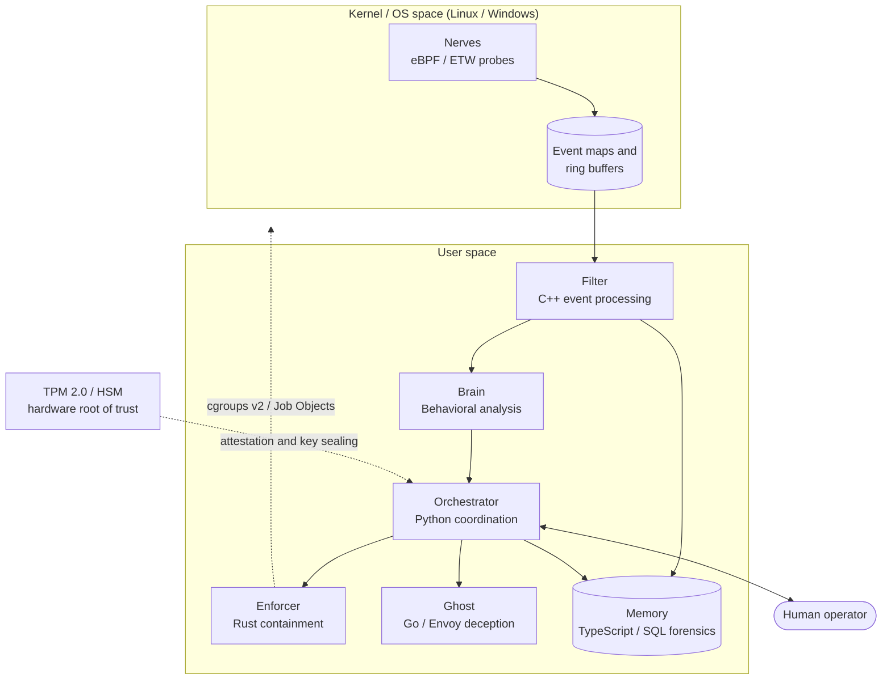
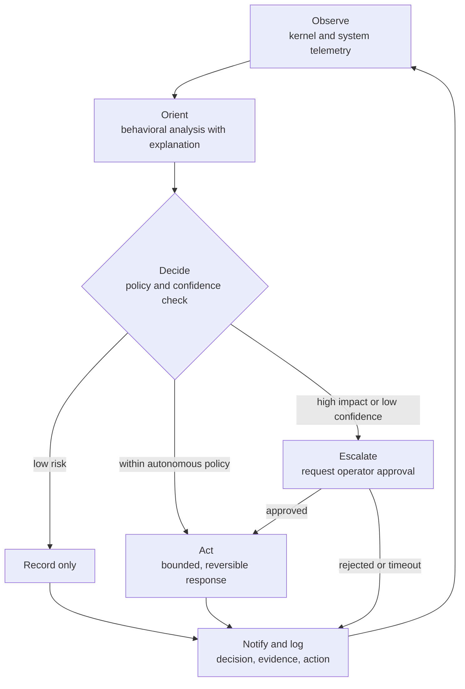

<p align="center">
  
</p>

<h1 align="center">Amphi</h1>

<p align="center"><strong>The Autonomous Immune System for Critical Infrastructure</strong></p>

<p align="center"><em>"Stop configuring alerts. Start building systems that understand and defend themselves."</em></p>

---

> **Project status: pre-alpha, architecture and repository scaffolding only.**
> This repository currently contains the design of Amphi and a skeleton of its intended layout. **No runtime component is implemented yet**: there is no eBPF, ETW, C++, Rust, Mojo, Go, or TypeScript source, no build system, no tests, and no benchmarks. Every capability described below is a design goal unless it is explicitly marked otherwise. See [Project Status](#project-status) for the evidence.

## Table of Contents

- [Project Overview](#project-overview)
- [Project Status](#project-status)
- [The Problem](#the-problem)
- [The Vision](#the-vision)
- [Design Principles](#design-principles)
- [System Architecture](#system-architecture)
- [The Seven Core Components](#the-seven-core-components)
- [Advanced Research and Subsystems](#advanced-research-and-subsystems)
  - [Encrypted Traffic Visibility](#encrypted-traffic-visibility)
  - [Graduated Containment](#graduated-containment)
  - [Hardware Telemetry](#hardware-telemetry)
  - [Hardware Root of Trust](#hardware-root-of-trust)
  - [Continuous Self-Audit](#continuous-self-audit)
  - [Digital Twin Playback](#digital-twin-playback)
- [Cerberus-Core](#cerberus-core)
- [MorphBPF and Hardware Compatibility](#morphbpf-and-hardware-compatibility)
- [AmphiLang](#amphilang)
- [The Glass Box Philosophy](#the-glass-box-philosophy)
- [Operational Lifecycle](#operational-lifecycle)
- [CLI Design](#cli-design)
- [Self-Healing and Decision Engine](#self-healing-and-decision-engine)
- [Swarm Intelligence](#swarm-intelligence)
- [Security Model and Architectural Risks](#security-model-and-architectural-risks)
- [Development Roadmap](#development-roadmap)
- [Related Ecosystem](#related-ecosystem)
- [Technical Requirements](#technical-requirements)
- [Building, Running, and Testing](#building-running-and-testing)
- [Research and Future Directions](#research-and-future-directions)
- [Contributing](#contributing)
- [License](#license)
- [Author](#author)

---

## Project Overview

Amphi is a proposed **cross-platform** low-level security and observability core for **Linux and Windows**. It explores the move from traditional observability, which collects data and raises alerts for humans, to an **autonomous, behavioral, explainable, and controlled** defense architecture: a system that observes at the kernel boundary, models what normal behavior looks like, reasons about deviations, and responds within limits that its operators define.

Amphi is not intended to be a conventional antivirus or a metrics dashboard. It is an attempt to combine four ideas that are usually built separately:

1. Kernel and OS-level telemetry (eBPF on Linux, ETW/WMI on Windows).
2. Behavioral analysis instead of signature matching alone.
3. Graduated, reversible response, with a human in control of high-impact actions.
4. Forensic evidence that is captured as part of the defense, not reconstructed afterwards.

**Why "Amphi"?** The prefix comes from the Ancient Greek *amphi*, meaning "on both sides" or "around". It refers to the system's two habitats, kernel space where the system acts and user space where applications run, and to protection that spans both.

### Scope and relationship to KORE Platform

Amphi is the **low-level cross-platform security and observability core**. The KORE Platform is a separate, higher-level ecosystem that may integrate Amphi alongside other projects. KoreAI, Tenentis OS, Lume-Gateway, DriftGuard, and the Decision Engine are **not** part of Amphi and are not implemented here. They are listed under [Related Ecosystem](#related-ecosystem) as related projects and planned integrations.

## Project Status

Status labels used throughout this document:

| Label | Meaning |
| --- | --- |
| **Implemented** | Working code exists in this repository and has been verified. |
| **In Progress** | Work has started in the repository but is incomplete. |
| **Planned** | The design is scoped and feasible with well-understood techniques. No code exists yet. |
| **Research** | Feasibility, correctness, or value is an open question. No code exists yet. |

The status below comes from inspecting the repository contents, not from earlier documentation.

| Area | Intended technology | Status | Evidence |
| --- | --- | --- | --- |
| Repository scaffolding | Directory layout, placeholder files | **In Progress** | 22 placeholder files exist (1 byte each, a single newline); no content. |
| Architecture documentation | Markdown | **In Progress** | This README. `docs/*.md` files are empty placeholders. |
| Nerves | C / eBPF (Linux) / ETW (Windows) | **Planned** | No `.c` or BPF source in the repository. |
| Filter | C++ | **Planned** | No C++ source. |
| Orchestrator | Python | **Planned** | `cli/` and `daemon/watchdog/monitor.py` exist but are empty. |
| CLI (`amphi`) | Python | **Planned** | `cli/main.py`, `cli/commands/start.py`, `cli/commands/isolate.py` are empty. |
| Enforcer | Rust | **Planned** | No Rust source or `Cargo.toml`. |
| Memory | TypeScript / SQL | **Planned** | No source; `deploy/docker/Dockerfile.memory` is empty. |
| Policy profiles | YAML | **Planned** | `config/amphi.yaml` and `config/profiles/{paranoid,balanced,learning}.yaml` are empty. |
| Deployment (Docker, Helm) | Docker, Helm | **Planned** | Dockerfiles, `Chart.yaml`, and `values.yaml` are empty. |
| Brain | Mojo / Python | **Research** | No source. Behavioral modeling and IRL are open research questions. |
| Ghost | Go / Envoy | **Research** | No source. Moving Target Defense and deception are unproven here. |
| Cerberus-Core | Not finalized | **Research** | Design notes only. |
| MorphBPF | Not finalized | **Research** | Design notes only. |
| AmphiLang (MLIR-based) | Not finalized | **Research** | Design notes only. |
| Swarm Intelligence | Not finalized | **Research** | Design notes only. |
| Tests, benchmarks, CI | n/a | **Planned** | None exist. |

At present nothing is **Implemented**.

## The Problem

Modern infrastructure is defended mostly by static controls: signature databases, threshold alerts, and perimeter rules. They share structural weaknesses.

- **Signatures lag behind attackers.** Previously unseen techniques are, by definition, absent from signature sets.
- **Alert-centric monitoring shifts work to humans.** Threshold alerts produce noise, and operators learn to distrust them, which is itself a security risk.
- **User-space visibility can be bypassed.** Monitoring that depends on agents or libraries in the same trust domain as the workload is easier for an attacker to evade or disable.
- **Detection and forensics are disconnected.** By the time an incident is investigated, volatile evidence is often gone.
- **Automated response is risky.** Aggressive automation can cause outages, so many teams avoid enabling it at all.

## The Vision

Amphi aims at a system that can:

- observe system behavior from the kernel/OS boundary with bounded, measured overhead;
- learn per-workload behavioral baselines and flag deviations with an explanation;
- respond proportionally, from alert to throttling to isolation, with reversibility and human approval for high-impact actions;
- preserve evidence at the moment of an incident for later analysis and replay;
- optionally share validated threat indicators with other nodes without exposing sensitive local data.

The operating model is a closed **OODA loop** (Observe, Orient, Decide, Act) with a notification and review stage, described in [Self-Healing and Decision Engine](#self-healing-and-decision-engine).

## Design Principles

| Principle | What it means in Amphi |
| --- | --- |
| **Evidence over assertion** | Performance, detection quality, and overhead claims require reproducible benchmarks. None are made today. |
| **Glass box, not black box** | Every automated decision must be explainable: inputs, rule or model, confidence, and action taken. See [The Glass Box Philosophy](#the-glass-box-philosophy). |
| **Human-in-the-Loop** | High-impact or low-confidence decisions go to an operator. Autonomy is earned per action class through observation modes. |
| **Fail-safe enforcement** | When the analysis layer is uncertain, the default is to alert and preserve evidence, not to terminate workloads. |
| **Fail-closed integrity** | When Amphi detects tampering with itself, it should withhold trust (for example credentials and attestation) from the affected node. This trades availability for integrity and must be configurable per environment. |
| **Defense in depth** | No single mechanism (eBPF, ETW, cgroups, Job Objects, TPM, a model) is treated as sufficient. |
| **Least privilege and minimal kernel footprint** | Kernel/OS-side programs stay small, auditable, and unloadable at any time. |
| **Reversibility** | Containment actions should be undoable, rate-limited, and bounded in blast radius. |

## System Architecture

Amphi is organized as seven cooperating components, informally called organs. Telemetry flows from kernel/OS-space probes through noise reduction into analysis, and a separate coordination layer decides whether and how to act.



*All components in this diagram are in the Planned or Research state.* The data path (Nerves to Filter to Brain) is intended to stay independent of the control path (Orchestrator to Enforcer and Ghost), so that heavy analysis cannot stall enforcement and enforcement cannot be triggered without passing a policy decision.

**Cross-Platform Abstraction (OSAL):** The architecture uses an OS Abstraction Layer. On Linux, *Nerves* uses eBPF and *Enforcer* uses cgroups v2. On Windows, *Nerves* uses ETW (Event Tracing for Windows) and WMI, while *Enforcer* uses WinAPI (Job Objects and process freezing APIs). The Orchestrator and Filter normalize these events so the Brain receives a unified schema.

## The Seven Core Components

| Component | Language | Role | Status |
| --- | --- | --- | --- |
| **Nerves** | C (Linux) / C++ (Windows) | OS-level observability: syscalls, network, and disk operations. eBPF (tracepoints, kprobes) on Linux; ETW/WMI on Windows. | Planned |
| **Filter** | C++ | Event normalization, enrichment, aggregation, and noise reduction between the OS and the analysis layer. | Planned |
| **Brain** | Mojo / Python | Behavioral baselining, anomaly detection, and research into Inverse Reinforcement Learning (IRL). | Research |
| **Enforcer** | Rust | Controlled containment, isolation, and mitigation. Uses cgroups v2 on Linux and WinAPI Job Objects on Windows. | Planned |
| **Memory** | TypeScript / SQL | Forensic storage, event history, and investigation interface. | Planned |
| **Ghost** | Go / Envoy | Moving Target Defense and deception infrastructure. | Research |
| **Orchestrator** | Python | Coordination, policy distribution, automation, and external integrations. | Planned |

### Nerves

Nerves is the sensory layer. On Linux, eBPF programs attach to kernel hooks and write compact events to shared maps and ring buffers. On Windows, Nerves utilizes Event Tracing for Windows (ETW) and Windows Management Instrumentation (WMI) to capture deep system events. Both provide low-overhead, OS-native visibility that is harder to evade than standard user-space instrumentation. It is not free: probe cost scales with event rate, and overhead must be measured per hook and workload. Privileged attackers can also detach or tamper with these probes, which is why self-integrity checks are part of the design.

### Filter

Filter sits between raw events and analysis. A busy host can generate far more events than a model should ingest, so Filter performs normalization, deduplication, rate-aware sampling, and enrichment (process lineage, container and cgroup/Job Object identity). Filtering is a trade-off: discarding events reduces forensic completeness. The design therefore keeps a bounded raw-event buffer in Memory, so reduction affects what the Brain sees, not what investigators can later retrieve.

### Brain

Brain consumes filtered events and produces behavioral assessments. The core ideas are per-workload baselines (for example, which files a process normally reads, which peers it contacts), anomaly scoring, and an explanation attached to each score. Inverse Reinforcement Learning, which infers a reward function that would explain observed behavior, is an **active research direction**, not a planned deliverable. IRL outputs are probabilistic hypotheses about intent; they do not allow a system to know an attacker's next steps.

### Enforcer

Enforcer executes containment decisions handed down by policy: throttle, freeze, isolate, block, or terminate. Rust provides memory-safety guarantees for safe code, which is valuable for a privileged component. On Linux, it leverages cgroups v2 controllers. On Windows, it interacts with the Win32 API (Job Objects, thread suspension). It does not remove logic bugs, deadlocks, panics, misconfiguration, or incorrect decisions, so Enforcer needs bounded actions, an audit trail, dry-run support, and tested rollback.

### Memory

Memory is the forensic record, the "black box" of the system. It stores events, decisions with their explanations, and selected context captured around incidents, and exposes them for investigation. What to capture (for example process memory snapshots) and how to store it safely is a significant design question: captured memory can contain secrets and personal data, so retention, encryption, and access control are requirements, not options.

### Ghost

Ghost explores Moving Target Defense and deception: decoy services, rotating exposure, and traffic steering that waste attacker time and generate high-signal detections. Deception is effective mainly for catching reconnaissance and lateral movement, and it adds operational complexity. This is why Ghost is classified as Research.

### Orchestrator

Orchestrator is the control plane. It distributes policy, correlates signals, applies the decision logic that gates the Enforcer, handles operator approval, and integrates with external systems such as SIEMs and cloud APIs. It deliberately stays off the high-rate data path.

## Advanced Research and Subsystems

The items below are design directions. None is implemented.

### Encrypted Traffic Visibility

Kernel-level network hooks (XDP/TC on Linux, WFP on Windows) cannot read TLS payloads. The design considers **uprobes and uretprobes** on user-space crypto libraries on Linux, and **WinAPI detours or ETW** on Windows, to observe data at the library boundary before encryption or after decryption. This gives useful but **partial** visibility. Statically linked, stripped, or custom crypto is not covered. Capturing plaintext has privacy and legal implications that need explicit policy. Status: Research.

### Graduated Containment

Instead of immediately terminating a suspicious process, the Enforcer could first **constrain** it. On Linux, this uses cgroups v2 (e.g., `cpu.max`, `io.max`, `cgroup.freeze`). On Windows, it uses Job Objects with strict CPU and memory limits. This can slow the process, limit its damage rate, and preserve its state for investigation. Throttling reduces the rate of harm; it does not stop it. Status: Planned.

### Hardware Telemetry

The design includes sampling CPU Performance Monitoring Counters (PMCs). On Linux, this is done through `perf_events`; on Windows, through Performance Counters and ETW. It looks for microarchitectural anomalies (cache misses, branch mispredictions) to detect behaviors that syscall telemetry cannot show. Signals are noisy and many virtualized environments restrict access. Status: Research.

### Hardware Root of Trust

A TPM 2.0 or HSM can provide measured boot, remote attestation, and keys sealed to a platform state. Amphi intends to use this so that, if the agent or host is tampered with, credentials needed to participate in the trusted environment become unavailable. On Windows, this integrates with TPM-based BitLocker and Measured Boot. Any "lock-down" behavior must be implemented by software and policy. Status: Planned for the watchdog; Research for end-to-end fail-closed behavior.

### Continuous Self-Audit

Inspired by Chaos Engineering, a self-audit module would periodically execute **non-destructive synthetic behaviors** (for example reading a protected file or opening a decoy port) to verify that probes, detections, and Ghost decoys are alive. Status: Planned.

### Digital Twin Playback

Digital Twin Playback is the idea of replaying recorded incident data in an isolated environment to study attacker behavior. Fidelity depends on what Memory captured; replay of a real exploit in a sandbox must itself be safely isolated. Status: Research.

## Cerberus-Core

Cerberus-Core is a research subsystem for correlating three analytical dimensions, named for the three-headed guardian of Greek myth.

| Head | Dimension | Intended mechanism | Notes |
| --- | --- | --- | --- |
| `flow_state` | Network and logic | Persistent per-connection state in shared maps, enabling detection of fragmented or low-and-slow behavior. | State tables need bounded memory and eviction to avoid becoming a denial-of-service target. |
| `hardware_pmu` | CPU and hardware | PMC sampling to detect microarchitectural anomalies. | Heuristic and noisy; limited in virtualized environments. |
| `self_guard` | Self-integrity | Integrity checks over Amphi's own tables and pointers, for example HMAC validation of critical state. | Aims at tamper detection. It cannot make a compromised privileged environment safe by itself. |

A correlation step would raise confidence when independent dimensions agree. A correlated alert is still evidence, not proof.

## MorphBPF and Hardware Compatibility

MorphBPF is the proposed compatibility layer for hardware and driver differences. Network cards and drivers differ in XDP support, packet header offsets, offload capabilities, and metadata. On Windows, this translates to abstracting differences between NDIS filter drivers and WFP (Windows Filtering Platform) callouts. MorphBPF is intended to normalize these differences so that upstream analysis sees a consistent view of packets. Status: Research.

## AmphiLang

AmphiLang is a proposed specialized language for security policy and detection logic. The intent is to let defenders express stateful behavioral rules declaratively and compile them to native OS probes (eBPF on Linux, WFP/ETW on Windows). [MLIR](https://mlir.llvm.org/) is considered as the compiler infrastructure. Status: Research.

## The Glass Box Philosophy

Amphi treats opaque automation as a liability in critical infrastructure. The Glass Box principle requires that any automated action be explainable and auditable.

For each decision, the system should be able to show:
1. **Inputs**: which events and features were considered.
2. **Reasoning**: which rule or model version produced the assessment, and its score.
3. **Confidence and its limits**: a model confidence score is a statistical output, not proof of an attack.
4. **Action taken**, and whether it was automatic or operator-approved.
5. **Reversal path**.

**Human-in-the-Loop** is built on this. The planned policy profiles are:

| Profile | Intended behavior |
| --- | --- |
| `learning` | Observe and record. Never take blocking action. |
| `balanced` | Act automatically only on high-confidence, low-blast-radius responses; escalate the rest to an operator. |
| `paranoid` | Strongest enforcement, with correspondingly higher risk of disrupting legitimate workloads. |

Explainability techniques are Research. The profile mechanism is Planned.

## Operational Lifecycle

The following describes the intended lifecycle. None of it is implemented.

### Startup (`amphi start`)

1. **Bootstrapping and integrity check**: verify kernel/OS support for required features (BPF on Linux, ETW providers on Windows).
2. **Probe loading**: load compiled probes and attach them to the configured hooks.
3. **Optional swarm synchronization**: connect to a federated cluster to receive validated threat indicators.

### Operational states

| Command | OS Probes | Analysis (Brain) | Forensic logging |
| --- | --- | --- | --- |
| `pause` | Attached (passive monitoring) | Disabled | Active |
| `stop` | Detached | Disabled | Inactive |
| `shutdown` | Detached and cleaned | Disabled | Removed |

### Fail-closed supervision

A watchdog supervises the agent. If Amphi is stopped without authorization, the intended behavior is to alert and withhold trust as described in [Hardware Root of Trust](#hardware-root-of-trust).

## CLI Design

The CLI is a **design proposal**. The only evidence in the repository is empty placeholder modules for `start` and `isolate` under `cli/commands/`.

### `amphi` commands

| Group | Command | Intended behavior | Status |
| --- | --- | --- | --- |
| Lifecycle | `amphi start` / `pause` / `stop` / `shutdown` | Control the agent as described in [Operational Lifecycle](#operational-lifecycle). | Planned |
| Health | `amphi status` | Show agent and probe health and recent detections. | Planned |
| Health | `amphi pulse` | Verify the integrity and liveness link between user-space agent and OS probes. | Planned |
| Health | `amphi audit` | Produce a report of recent actions and decisions for review. | Planned |
| Response | `amphi isolate <PID>` | Constrain a process using cgroups v2 (Linux) or Job Objects (Windows). | Planned |
| Response | `amphi simulate <type>` | Run synthetic, non-destructive behaviors to test detection. | Planned |
| Policy | `amphi policy --set <mode>` | Switch among `learning`, `balanced`, and `paranoid`. | Planned |
| Policy | `amphi config --reload` | Reload configuration without restarting the agent. | Planned |
| Forensics | `amphi dump <incident_id>` | Export the evidence captured for an incident. | Research |
| Forensics | `amphi replay <incident_id>` | Replay an incident in an isolated environment. | Research |
| Swarm | `amphi swarm-join <token>` | Join a federated cluster. | Research |
| Swarm | `amphi vaccinate <threat_id>` | Exchange a validated threat indicator with the cluster. | Research |

## Self-Healing and Decision Engine

Self-healing here means **policy-bound automated response**, structured as an OODA loop.



A **decision engine** evaluates rules against assessments and decides whether the response is automatic or requires approval. Its placement is an open design question.

### Example policy (illustrative pseudo-configuration)

```yaml
# Illustrative pseudo-configuration, not a real or supported format.
rules:
  - name: "high-confidence-anomalous-process"
    when:
      assessment: "behavioral_anomaly"
      min_confidence: 0.95          # thresholds must be calibrated, not assumed
    action: "throttle_in_cgroup"    # bounded and reversible
    requires_approval: false
    notify: "immediate"

  - name: "possible-data-exfiltration"
    when:
      assessment: "anomalous_egress"
      min_confidence: 0.80
    action: "isolate_and_capture_evidence"
    requires_approval: true         # high impact: a human decides
    notify: "immediate"
```

### Guardrails

Automated response needs protections of its own: per-action rate limits, a maximum blast radius, an allowlist of critical processes that are never auto-contained, dry-run mode, and a global kill switch.

## Swarm Intelligence

Swarm Intelligence is the long-term idea of nodes sharing **validated threat indicators** (informally "vaccines") so that an attack observed on one node can improve detection on others. Required foundations include Mutual TLS for node identity, signed and versioned indicators, validation to prevent poisoning, and privacy mechanisms like Differential Privacy (DP) to strip sensitive data. Status: Research.

## Security Model and Architectural Risks

### Assumptions and non-goals

- Amphi is a defense-in-depth layer. It does not replace patching, least-privilege design, network segmentation, or conventional endpoint protection.
- An attacker who obtains full kernel-level or SYSTEM-level control can defeat any host-based defense. Amphi aims to raise the cost of attack and make tampering detectable.
- Amphi will itself be privileged software, so it is part of the attack surface.

### Claims that need qualification

| Original-style claim | Technical reality | Design response |
| --- | --- | --- |
| The eBPF verifier makes kernel crashes structurally impossible. | The verifier statically rejects many unsafe programs at load time. It does not guarantee the absence of kernel crashes. | Keep programs minimal, test across a kernel matrix, bound map memory. |
| Uprobes on `SSL_read` and `SSL_write` give 100% visibility. | Coverage is partial: static linking, other TLS stacks (Go, Java, rustls) are not covered. | Document supported libraries and treat coverage as a measured quantity. |
| Cgroups v2 provides a sandbox. | It controls resources. It does not restrict privileges. | Combine with namespaces, seccomp, LSM policy, and network controls. |
| A TPM locks the node when tampered with. | A TPM provides measurement, attestation, and key sealing. It does not enforce blocking by itself. | Implement lock-down in a watchdog and key policy. |
| Rust guarantees the Enforcer cannot fail. | Rust prevents memory errors in safe code. It does not prevent logic errors, panics, or bad decisions. | Bounded actions, rate limits, dry-run, and tests. |
| IRL predicts the attacker's next moves. | IRL infers likely objectives under assumptions. | Treat as research; never use as the sole basis for action. |
| A 95% AI confidence score confirms an attack. | A score is a model output, not proof. | Gate high-impact actions on human review. |

### Principal architectural risks

| Risk | Description | Mitigation direction |
| --- | --- | --- |
| **Kernel instability** | Kernel-resident code expands the blast radius of mistakes. | Minimal probes, verifier plus kernel-matrix CI, safe unload. |
| **Performance overhead** | Syscall tracing and uprobes cost CPU. | Early filtering, per-hook budgets, published benchmarks. |
| **False positives** | Legitimate updates or traffic spikes can resemble anomalies. | Observation mode first, calibrated thresholds, approval gates. |
| **Self-compromise** | A privileged component is an attractive target. | Integrity checks, minimal privileges, signed artifacts. |
| **Evidence sensitivity** | Forensic captures may hold secrets and personal data. | Encryption, retention policy, access control. |

## Development Roadmap

The roadmap is ordered by dependency and feasibility. Dates are intentionally omitted.

| Phase | Focus | Scope | Status |
| --- | --- | --- | --- |
| **Phase 1: Amphi Insight** | OS observability | Nerves probes (eBPF/ETW); event collection; initial CLI; integration tests; threat model. | Planned |
| **Phase 2: Behavioral Monitoring** | Understanding normal | Event correlation; behavioral baselines; anomaly detection; forensic event storage. | Planned |
| **Phase 3: Controlled Enforcement** | Safe response | Rust Enforcer; cgroups v2 / Job Objects containment; permission model; recovery. | Planned |
| **Phase 4: Cognitive Analysis** | Learning and explanation | Brain in Mojo; behavioral models; explainability; IRL research. | Research |
| **Phase 5: Federated Defense** | Cooperation | Secure node communication; validated threat indicators; privacy-preserving sharing. | Research |

## Related Ecosystem

The **KORE Platform** is a higher-level ecosystem of related projects that may integrate Amphi. It is separate from Amphi. None of these projects is included in or integrated with this repository.

| Project | Described role | Relationship to Amphi |
| --- | --- | --- |
| KORE Platform | Umbrella ecosystem for higher-level services. | Separate. May consume Amphi telemetry and decisions. |
| KoreAI | AI agents and retrieval. | Related. Possible future integration. |
| Tenentis OS | Multi-tenant SaaS platform. | Related. Not a dependency. |
| Lume-Gateway | Traffic gateway. | Related. Possible integration for network-side response. |
| DriftGuard | Cognitive observability, FinOps, GreenOps. | Related. Possible telemetry source. |
| Decision Engine | Rule-driven coordination of automated responses. | Placement undecided. |

## Technical Requirements

These are **design targets**. No build manifest in the repository verifies or enforces them.

| Requirement | Target and rationale |
| --- | --- |
| Operating system | **Linux** (Kernel 5.8+) and **Windows** (10 / Server 2019+). |
| Kernel (Linux) | 5.8 or newer is the intended baseline (BPF ring buffers). |
| BTF (Linux) | Kernel BTF (`CONFIG_DEBUG_INFO_BTF`) for CO-RE portability. |
| Cgroups (Linux) | Unified cgroup v2 hierarchy for the Enforcer. |
| Windows Telemetry | Requires administrative privileges to access ETW providers and WMI. |
| WinAPI (Windows) | Usage of Job Objects and Win32 APIs for process freezing and containment. |
| Privileges | Loading BPF programs, accessing ETW, and managing processes requires elevated privileges (root/SYSTEM). |
| Toolchains by component | Clang/LLVM, a C++ toolchain, Rust, Go, Node.js/TypeScript, Python 3. Exact versions are not yet fixed. |
| Optional | TPM 2.0 or HSM for attestation and key sealing. |

## Building, Running, and Testing

**There are currently no verified build, installation, run, or test procedures**, because the repository contains no implementation. This README deliberately provides no install command and no download URL. Any such command will be added only after it has been executed and verified.

Planned engineering gates for Phase 1:
- A build system and a continuous-integration pipeline.
- Integration tests that load probes on a matrix of kernel versions and Windows builds.
- A reproducible benchmark harness that reports overhead against an uninstrumented baseline.

## Research and Future Directions

All ideas below are Research unless stated.

| Area | Direction | Notes |
| --- | --- | --- |
| Cognition | Explainable AI for Brain decisions | Core to the Glass Box principle. |
| Cognition | NLP over CVEs and threat reports to propose detection rules | Output must be reviewed by humans. |
| Defense | Workload migration under attack | Depends on orchestration platform support. |
| Defense | Synthetic deception infrastructure | Extension of Ghost. |
| Platform | Kubernetes operator and CRD-based policy | Planned candidate after the core exists. |
| Platform | eBPF for Windows | Monitor the maturity of the official project for future integration. |
| Performance | SmartNIC and DPU offload | Throughput claims require measurement. |
| Operations | Control center dashboard | Visualization and replay of incidents. |
| Operations | Compliance reporting (GDPR, NIS2, ISO 27001) | Amphi could supply evidence for audits. |

## Contributing

The project is at the design stage and contributions are most useful as **technical review**. Feedback is especially valuable on the threat model, probe design, benchmark methodology, and the AmphiLang design questions. Please open an issue to start a discussion before sending a large change.

## License

No license file is currently included in this repository, and licensing terms have not been published yet.

## Author

**Kauan Oliveira**,
[github.com/kauand3v](https://github.com/kauand3v)
```
